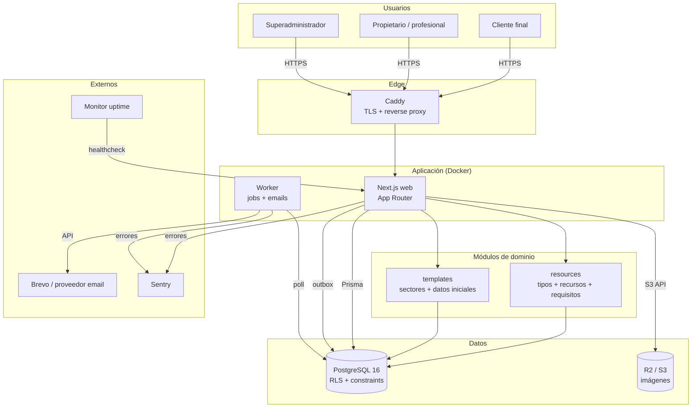
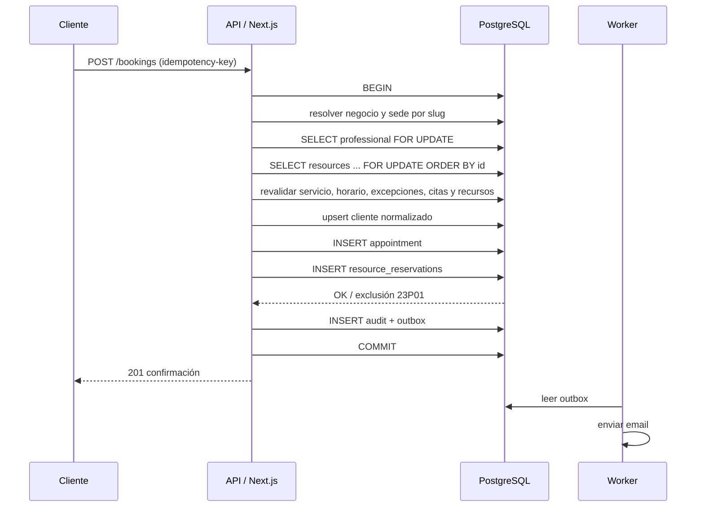

# ARCHITECTURE.md — Arquitectura técnica

**Producto:** Velora (nombre de trabajo)  
**Documento:** propuesta de arquitectura para aprobación  
**Versión:** 1.1  
**Estado:** Fase 0 implementada; diseño de fases posteriores  
**Cambios v1.1:** recursos físicos, plantillas sectoriales, Auth.js, concurrencia de recursos y relaciones multisede.

---

## 1. Resumen

Velora se construirá como un **monolito modular** sobre Next.js App Router, TypeScript y PostgreSQL. Una sola aplicación web, un proceso worker para tareas en segundo plano y una base de datos. No habrá microservicios en el MVP.

La arquitectura persigue cuatro propiedades:

1. **Aislamiento estricto por empresa.** Todas las tablas de negocio llevan `business_id`; la capa de acceso exige contexto de empresa; PostgreSQL aplica Row Level Security como segunda barrera.
2. **Corrección en la agenda.** La disponibilidad se calcula en servidor y las citas se protegen con transacciones, bloqueo por profesional y una exclusion constraint en base de datos.
3. **Bajo coste operativo.** Docker Compose en un VPS europeo, PostgreSQL local, almacenamiento S3-compatible y email transaccional. Sin Redis, sin Kubernetes, sin servicios innecesarios.
4. **Ruta de crecimiento clara.** El mismo código puede pasar de un VPS a varios contenedores y a PostgreSQL gestionado sin reescribir los módulos.

---

## 2. Principios de diseño

| Principio | Aplicación |
|---|---|
| Modular por dominio | Cada módulo contiene sus esquemas, casos de uso, repositorios y componentes de UI. |
| Servidor como fuente de verdad | Permisos, límites, precios y disponibilidad se validan siempre en servidor. |
| Tenant explícito | Ninguna consulta de negocio se ejecuta sin `business_id` y sin contexto de base de datos. |
| Simplicidad primero | Una base de datos, una cola, un despliegue. Se añade complejidad solo con evidencia. |
| Fallar seguro | Si falta contexto de tenant, la consulta no devuelve datos; no se degrada a acceso global. |
| Idempotencia | Reservas, emails y jobs pueden reintentarse sin duplicar efectos. |
| Dinero en enteros | Importes en céntimos; nunca `float`. |
| Tiempo en UTC | `timestamptz` en base de datos; conversión a zona del negocio en los bordes. |
| Observabilidad desde el inicio | Request ID, logs estructurados, auditoría y métricas de negocio. |

---

## 3. Contexto y contenedores



### 3.1 Contenedores lógicos

| Contenedor | Responsabilidad | Escala |
|---|---|---|
| Web | Renderizado, panel, web pública, API, server actions. | Horizontal, sin estado. |
| Worker | Envío de emails, recordatorios, jobs periódicos, limpieza. | Uno o varios con `SKIP LOCKED`. |
| PostgreSQL | Datos, RLS, constraints, cola/outbox. | Vertical primero; gestionado después. |
| R2/S3 | Logos, fotos, imágenes de servicios. | Gestionado. |
| Caddy | TLS, compresión, cabeceras, proxy. | Uno por VPS. |

No hay microservicios, API gateway, Redis, Kubernetes ni bus de eventos en el MVP.

---

## 4. Stack y decisiones

| Capa | Elección | Alternativas evaluadas | Motivo |
|---|---|---|---|
| Runtime | Node.js 22 LTS + pnpm | Bun, Deno | Estabilidad, ecosistema y soporte a largo plazo. |
| Framework | Next.js App Router + React + TypeScript | Remix, SvelteKit, NestJS + SPA | SSR/SEO para la web pública, server actions para el panel, un solo despliegue. |
| Estilos | Tailwind CSS + Radix UI + CVA | shadcn/ui completo, MUI, Chakra | Control visual, accesibilidad y componentes propios sin dependencia de un tema ajeno. |
| ORM | Prisma | Drizzle, Kysely, SQL puro | DX, migraciones y tipado; SQL manual para constraints avanzados. |
| Base de datos | PostgreSQL 16 | SQLite, MySQL | Transacciones, RLS, exclusion constraints, `jsonb`, `timestamptz`. |
| Auth | Auth.js v5 + Prisma Adapter; Google OAuth y enlace mágico | Módulo propio, Clerk, Supabase Auth | Auth estándar, sesiones en BD, menos superficie de seguridad propia. |
| Validación | Zod | Yup, Valibot | Esquemas compartidos y mensajes claros. |
| Formularios | React Hook Form | Formik, formularios nativos | Rendimiento y ergonomía. |
| Cola | pg-boss + outbox transaccional | BullMQ/Redis, Graphile Worker | Menos infraestructura; persistencia y reintentos. |
| Email | Adaptador; Brevo por defecto | Resend, SES, Postmark | Proveedor europeo, coste bajo, API sencilla. |
| Imágenes | R2 + sharp | Disco local, Cloudinary | Fuera del contenedor, egress gratuito, re-encode seguro. |
| Despliegue | Docker Compose + Caddy en VPS | Vercel + Neon, Fly.io, Railway | Coste bajo, portabilidad, control de datos en la UE. |
| Tests | Vitest + Testing Library + Playwright | Jest, Cypress | Velocidad y buena integración con Next.js. |
| Observabilidad | pino + Sentry + uptime externo | Datadog, New Relic | Coste cero o bajo en MVP; suficiente para diagnosticar. |

Las versiones mayores se fijan en la Fase 0 con la última estable compatible. No se fijan versiones concretas en este documento para evitar que queden obsoletas antes de implementar.

---

## 5. Monolito modular

### 5.1 Estructura de carpetas

```text
src/
├── app/
│   ├── (public)/
│   │   └── p/[slug]/
│   │       ├── page.tsx
│   │       ├── reservar/page.tsx
│   │       └── cita/[token]/page.tsx
│   ├── (auth)/
│   │   ├── login/page.tsx
│   │   ├── acceso/page.tsx               # Solicitar enlace mágico
│   │   └── invitacion/[token]/page.tsx
│   ├── (app)/
│   │   └── app/
│   │       ├── page.tsx                 # Dashboard
│   │       ├── agenda/page.tsx
│   │       ├── citas/page.tsx
│   │       ├── clientes/page.tsx
│   │       ├── servicios/page.tsx
│   │       ├── equipo/page.tsx
│   │       ├── recursos/page.tsx
│   │       ├── estadisticas/page.tsx
│   │       └── ajustes/page.tsx
│   ├── (platform)/
│   │   └── platform/
│   │       ├── page.tsx
│   │       ├── empresas/page.tsx
│   │       ├── planes/page.tsx
│   │       └── auditoria/page.tsx
│   ├── api/
│   │   ├── auth/[...nextauth]/route.ts   # Auth.js
│   │   ├── v1/public/[slug]/availability/route.ts
│   │   ├── v1/public/[slug]/bookings/route.ts
│   │   ├── v1/public/bookings/[token]/route.ts
│   │   ├── v1/public/bookings/[token]/cancel/route.ts
│   │   ├── webhooks/email/route.ts
│   │   └── health/route.ts
│   ├── layout.tsx
│   └── globals.css
├── modules/
│   ├── auth/
│   │   ├── auth.config.ts               # Auth.js: Google + email
│   │   ├── providers.ts
│   │   ├── invitations.ts
│   │   └── guards.ts
│   ├── businesses/
│   ├── locations/
│   ├── memberships/
│   ├── services/
│   ├── professionals/
│   ├── resources/
│   │   ├── resource.service.ts
│   │   ├── requirements.ts
│   │   └── allocation.ts
│   ├── templates/
│   │   ├── template.service.ts
│   │   ├── apply.ts
│   │   └── catalog/
│   ├── scheduling/
│   │   ├── availability.ts
│   │   ├── slots.ts
│   │   └── timezone.ts
│   ├── appointments/
│   │   ├── booking.service.ts
│   │   ├── appointment.service.ts
│   │   └── cancellation.ts
│   ├── clients/
│   ├── notifications/
│   │   ├── outbox.ts
│   │   ├── templates/
│   │   └── providers/
│   ├── plans/
│   ├── analytics/
│   ├── audit/
│   └── media/
├── components/
│   ├── ui/                              # Button, Input, Dialog, Table...
│   ├── calendar/
│   ├── booking/
│   └── layout/
├── lib/
│   ├── db.ts
│   ├── tenant.ts
│   ├── auth.ts
│   ├── env.ts
│   ├── errors.ts
│   ├── logger.ts
│   ├── rate-limit.ts
│   └── storage.ts
└── worker/
    ├── index.ts
    └── jobs/
```

### 5.2 Reglas de módulo

- Un módulo no importa componentes de otro módulo; solo su servicio público o sus tipos.
- Los componentes de UI no acceden a Prisma directamente.
- Los route handlers y server actions son adaptadores finos: validan entrada, llaman al servicio y traducen errores.
- Los servicios de dominio reciben `TenantContext` o `PlatformContext` explícito.
- Las consultas se encapsulan en repositorios del módulo; no hay `prisma.appointment.findMany` disperso por la UI.
- Los esquemas Zod viven junto al módulo y se reutilizan en cliente y servidor cuando es seguro.

### 5.3 Módulos y responsabilidades

| Módulo | Responsabilidad | No incluye |
|---|---|---|
| auth | Auth.js, Google, enlace mágico, sesiones, invitaciones y guards. | Permisos de negocio. |
| businesses | Datos del negocio, slug, publicación, configuración pública. | Agenda. |
| locations | Sede activa y dirección; preparado para multi-sede. | Horarios. |
| memberships | Relación usuario-empresa y rol. | Datos de cliente. |
| services | Categorías, servicios, variantes, profesionales y requisitos de recursos. | Citas. |
| professionals | Perfil profesional, servicios, sedes, color, estado. | Disponibilidad calculada. |
| resources | Tipos de recurso, recursos por sede, requisitos, bloqueos y ocupación. | Agenda del profesional. |
| templates | Plantillas sectoriales, claves estables y aplicación no destructiva. | Datos del negocio ya existentes. |
| scheduling | Horarios, excepciones, generación de slots, zona horaria y asignación de recursos. | Persistencia de citas. |
| appointments | Creación, edición, cancelación, estados, cobro manual y reservas de recurso. | Envío de emails. |
| clients | Fichas, deduplicación, historial, exportación y anonimización. | Comunicaciones. |
| notifications | Outbox, plantillas, proveedores, reintentos y coste. | Lógica de agenda. |
| plans | Planes, suscripciones, límites y entitlements. | Facturación automática. |
| analytics | Métricas y agregados. | Contabilidad. |
| audit | Registro inmutable de acciones. | Métricas de producto. |
| media | Subida, validación, re-encode y borrado de imágenes. | Datos de negocio. |

---

## 6. Multitenencia

### 6.1 Modelo

**Una base de datos, un esquema, `business_id` en todas las tablas de negocio.** Es el modelo más adecuado para el MVP: coste bajo, operaciones simples y aislamiento suficiente con RLS.

```text
users ──< memberships >── businesses ──< locations ──< resources
                              │             │             │
                              │             ├──< business_hours
                              │             └──< resource_blocks
                              ├──< professionals ──< professional_locations
                              │                  └──< professional_schedules
                              ├──< services ──< service_variants
                              │            ├──< service_locations
                              │            ├──< service_professionals
                              │            └──< service_resource_requirements
                              ├──< clients
                              ├──< appointments ──< resource_reservations
                              ├──< schedule_exceptions
                              ├──< notification_outbox
                              ├──< audit_logs
                              └──< subscriptions
```

La empresa es el tenant; la sede es la unidad operativa. Profesionales, servicios y recursos se relacionan con las sedes mediante tablas N:N o claves compuestas, no mediante un único `location_id` en el profesional.

### 6.2 Resolución del tenant

| Contexto | Cómo se resuelve | Verificación |
|---|---|---|
| Panel `/app` | Sesión → membership activa → `business_id` | El usuario debe pertenecer a la empresa. |
| Cambio de empresa | Cookie `velora_business` solo entre memberships del usuario | Se valida en cada request. |
| Web pública `/p/[slug]` | Slug → función `get_public_business(slug)` | Solo empresas publicadas y activas. |
| API pública | Slug → misma función | Rate limit y validación de estado. |
| Plataforma `/platform` | Sesión con `is_superadmin` | Contexto `platform` explícito. |
| Worker | Job con `business_id` | Revalida empresa y suscripción antes de actuar. |

### 6.3 `TenantContext`

```ts
type TenantContext = {
  businessId: string;
  locationId?: string; // sede activa en el panel o resuelta por slug
  userId: string | null; // null en la web pública
  role: "owner" | "professional" | "public";
  professionalId?: string;
  allowedLocationIds?: string[]; // profesional multi-sede
};
```

Reglas:

- Se construye solo después de verificar la sesión y la membership.
- No se acepta `businessId` de un parámetro de URL o de un campo del formulario sin verificar la membership.
- Los servicios reciben el contexto; no leen cookies globales.
- El contexto de plataforma es distinto y solo lo usa el módulo de plataforma.

### 6.4 Defensa en profundidad

1. **Aplicación:** `withTenant` exige contexto y los repositorios filtran por `business_id`.
2. **Base de datos:** RLS con `current_setting('app.business_id')`.
3. **Constraints:** claves compuestas `(business_id, id)` en relaciones sensibles para impedir referencias cruzadas.
4. **Tests:** suite de aislamiento que intenta acceder a recursos de otra empresa por ID directo.

Detalle de políticas y tablas en [DATABASE.md](DATABASE.md#8-row-level-security-rls).

---

## 7. Autenticación y autorización

### 7.1 Auth.js

La autenticación se delega en **Auth.js v5 con Prisma Adapter**, no en un módulo propio.

**Proveedores:**

- **Google OAuth:** proveedor principal. Auth.js gestiona `state`, PKCE, canje de código, validación del perfil y vinculación de cuentas.
- **Email magic link:** alternativa para usuarios sin Google o que prefieran no usarlo. Auth.js genera y valida el token de un solo uso; el envío se hace con el adaptador de email de Velora.

**Sesiones:**

- Estrategia `database`, no JWT.
- Tabla `sessions` gestionada por el adapter; el token de sesión vive en la cookie de Auth.js.
- Cookie `HttpOnly`, `Secure`, `SameSite=Lax`.
- Revocación real: se borra la fila de sesión.
- “Cerrar todas las sesiones” borra todas las filas del usuario.
- El administrador puede revocar una sesión concreta.
- Duración máxima configurada (30 días); rotación al iniciar sesión.

**Sin contraseñas:**

- No se almacenan hashes de contraseña.
- No hay recuperación de contraseña ni tokens de reset propios.
- El enlace mágico cumple la función de acceso y recuperación.

**Invitaciones:**

- La invitación es un concepto de negocio, no de autenticación.
- Se guarda un token de invitación hasheado, con empresa, rol, sede(s), email y caducidad de 7 días.
- El invitado entra con Google o enlace mágico; después acepta la invitación.
- El email autenticado debe coincidir con el de la invitación.
- Si no hay invitación ni membership activa, el acceso al panel se deniega con un mensaje claro.

**Superadministrador:**

- `is_superadmin` en la base de datos.
- Google con 2FA; opcionalmente allowlist de emails.
- `/platform` separado y auditado.
- No se implementa impersonación.

**Seguridad OAuth:**

- Cliente OAuth **propio de Velora** en Google Cloud, con redirect URIs propias.
- Se puede compartir el proyecto/organización de Google Cloud con Empresites, pero **no el secreto del cliente OAuth**.
- No se copian credenciales de Empresites.
- Se exige email verificado por Google.
- Auth.js gestiona CSRF y state; no se implementa un flujo OAuth manual.
- Rate limit en inicio de sesión y solicitud de enlace mágico.

**Por qué no se reutiliza el auth de Empresites:** su implementación es un flujo OAuth propio con sesión HMAC sin estado, `state` fijo y sin revocación central. Confirma que Google OAuth funciona, pero no es una librería reutilizable ni el patrón que conviene para Velora.

### 7.2 Roles

| Rol | Ámbito | Permisos |
|---|---|---|
| `superadmin` | Plataforma | Empresas, planes, límites, métricas, soporte, auditoría global. |
| `owner` | Empresa | Todo el negocio: configuración, sedes, equipo, servicios, recursos, agenda, clientes, estadísticas, plan. |
| `professional` | Empresa + profesional + sedes asignadas | Su agenda, sus citas, recursos de su sede y datos de cliente permitidos; edición según permiso. |

No se añade rol "recepción" en el MVP. Si se necesita, se implementará como permiso adicional o rol específico en una fase posterior.

### 7.3 Matriz de permisos

| Acción | Superadmin | Owner | Professional |
|---|---:|---:|---:|
| Crear empresa | ✅ | — | — |
| Cambiar plan/límites | ✅ | — | — |
| Ver métricas globales | ✅ | — | — |
| Editar negocio | — | ✅ | — |
| Editar sedes | — | ✅ | — |
| Editar servicios | — | ✅ | — |
| Editar equipo | — | ✅ | — |
| Editar recursos | — | ✅ | — |
| Aplicar plantilla sectorial | — | ✅ | — |
| Ver agenda completa | — | ✅ | Solo la suya |
| Ver ocupación de recursos | — | ✅ | Su sede, si se habilita |
| Crear cita para cualquier profesional | — | ✅ | Solo la suya, si está permitido |
| Asignar/cambiar recurso | — | ✅ | Solo si está permitido |
| Editar/cancelar cita ajena | — | ✅ | — |
| Ver ficha de cliente | — | ✅ | Solo clientes con cita propia |
| Exportar clientes | — | ✅ | — |
| Anonimizar cliente | — | ✅ | — |
| Ver estadísticas | — | ✅ | Limitadas, si se habilita |

La matriz se implementa en un único módulo de autorización, no en condicionales dispersos.

---

## 8. Acceso a datos y RLS

### 8.1 Capa de acceso

Toda consulta de negocio pasa por `withTenant`:

```ts
export async function withTenant<T>(
  ctx: TenantContext,
  fn: (tx: Prisma.TransactionClient) => Promise<T>
): Promise<T> {
  return prisma.$transaction(async (tx) => {
    await tx.$queryRaw`select set_config('app.business_id', ${ctx.businessId}, true)`;
    await tx.$queryRaw`select set_config('app.user_id', ${ctx.userId ?? ""}, true)`;
    return fn(tx);
  });
}
```

Reglas:

- `set_config(..., true)` es local a la transacción; no se filtra entre conexiones del pool.
- Los repositorios reciben `tx`, no el cliente global.
- No se anidan transacciones de tenant.
- Las operaciones que necesitan varias escrituras van en la misma transacción.
- El contexto de plataforma usa `withPlatform` y `set_config('app.platform', 'on', true)`.
- La web pública usa `withTenant` después de resolver la empresa por slug; en ese caso `userId` puede ser `null` y se fija como cadena vacía.
- La resolución de membresías antes de tener empresa usa una transacción corta con `app.user_id`; nunca se consulta `memberships` sin contexto.

### 8.2 Roles de base de datos

| Rol | Uso | Permisos |
|---|---|---|
| `velora_owner` | Migraciones y tareas administrativas | Owner del esquema; no se usa en runtime. |
| `velora_app` | Runtime web y worker | `SELECT/INSERT/UPDATE/DELETE` sobre tablas; sin `BYPASSRLS`. |
| `velora_backup` | Copias | Solo lectura para `pg_dump`. |

`DATABASE_URL` apunta a `velora_app`; `DIRECT_URL`/`MIGRATE_DATABASE_URL` a `velora_owner`. Prisma CLI usa el segundo; la app usa el primero.

### 8.3 RLS

- RLS activado y forzado en todas las tablas con `business_id`.
- Política de tenant: `business_id = nullif(current_setting('app.business_id', true), '')::uuid`.
- Política de plataforma: `current_setting('app.platform', true) = 'on'`.
- Sin contexto, las consultas devuelven cero filas y las escrituras fallan.
- La tabla `businesses` se lee públicamente solo a través de una función `SECURITY DEFINER` que devuelve el perfil público; no se expone la tabla completa.
- `users`, `accounts`, `sessions` y `verification_tokens` son globales y los usa Auth.js. `memberships` tiene RLS con política de tenant, plataforma o `user_id = current_setting('app.user_id')`.

### 8.4 Constraints de tenant

En relaciones sensibles se usan claves compuestas:

```sql
-- Ejemplo conceptual
alter table services
  add constraint services_business_id_id_key unique (business_id, id);

alter table service_professionals
  add constraint service_professionals_service_fk
  foreign key (business_id, service_id)
  references services (business_id, id);
```

Esto impide que una fila de una empresa referencie un servicio de otra, incluso si la aplicación tiene un bug.

---

## 9. Motor de disponibilidad

### 9.1 Entradas

- Empresa, sede y zona horaria de la sede.
- Servicio y variante (duración, margen).
- Profesional o "cualquiera disponible".
- Requisitos de recursos del servicio para esa sede.
- Rango de fechas.
- Hora actual del servidor.
- Configuración: antelación mínima, antelación máxima, granularidad, horario comercial, horario del profesional, excepciones, citas, bloqueos de profesional y reservas de recursos.

### 9.2 Algoritmo

```text
1. Validar empresa activa, sede activa, servicio online y profesional cualificado.
2. Cargar requisitos de recursos del servicio para la sede.
3. Para cada día del rango:
   a. Convertir el día local a intervalos UTC.
   b. Construir intervalos de trabajo:
      intersección(horario comercial de la sede, horario del profesional en la sede)
      menos excepciones no disponibles
      más excepciones disponibles extra
   c. Restar citas activas, bloqueos de profesional y reservas de recursos.
   d. Generar candidatos cada `slot_interval_min` desde el inicio del intervalo.
   e. Descartar candidatos que:
      - empiecen antes de ahora + antelación mínima;
      - empiecen después de ahora + antelación máxima;
      - no quepan con duración + margen antes del cierre;
      - se solapen con otro intervalo ocupado.
   f. Para cada candidato, comprobar que existan recursos libres
      para todos los requisitos (tipo, cantidad y recurso concreto).
4. Si el profesional es "cualquiera", unir resultados por hora y elegir
   el profesional con menor carga ese día; desempate por orden.
5. Asignar recursos de forma determinista y devolver el slot con
   profesional, recursos y duración.
```

### 9.3 Semántica temporal

- Todos los instantes se guardan en `timestamptz` (UTC).
- Las reglas semanales se guardan como hora local (`time`) y se interpretan en la zona de la sede; si la sede no define una, hereda la del negocio.
- Los intervalos son **semiabiertos**: `[inicio, fin)`. Una cita que termina a las 10:00 no bloquea una que empieza a las 10:00.
- El margen posterior forma parte del intervalo ocupado: `blocked_until = service_end + buffer`.
- Cambios de hora: se usa IANA (`Europe/Madrid`), no offsets fijos. Las horas inexistentes se descartan; las ambiguas se resuelven a la primera ocurrencia.
- No se admiten horarios que crucen medianoche en el MVP; se valida `close > open`.

### 9.4 Rendimiento

- La UI pide como máximo una semana de disponibilidad por llamada.
- Se cargan horarios, excepciones, requisitos y reservas de recursos en bloque, no por profesional/día.
- Índices por `(business_id, location_id, professional_id, starts_at)`, `(business_id, location_id, starts_at)` y `(resource_id, starts_at)`.
- La respuesta se limita a los próximos 60–90 días.
- Objetivo p95 < 500 ms con 20 profesionales, 50 recursos y una semana.
- Si el número de combinaciones de recursos crece, se resuelve primero por tipo y se eligen recursos concretos solo en la confirmación.

### 9.5 Dónde vive la lógica

`src/modules/scheduling/availability.ts` es una función pura, sin Prisma ni cookies. Recibe datos ya cargados y devuelve slots. Así se puede testear con fechas, DST, buffers y excepciones sin base de datos.

---

## 10. Recursos físicos y concurrencia

### 10.1 Por qué no basta con la agenda del profesional

Una cita de masaje puede necesitar simultáneamente:

- Un profesional.
- Una camilla.
- Una cabina.

Una cita de manicura puede necesitar un profesional y un puesto de manicura. Una de peluquería puede necesitar un sillón y un lavacabezas. Si solo se protege la agenda del profesional, dos citas pueden reservar la misma cabina a la misma hora.

Por eso los recursos físicos son **entidades de primera clase** y tienen su propia garantía de exclusividad en PostgreSQL.

### 10.2 Modelo

| Entidad | Ámbito | Responsabilidad |
|---|---|---|
| `resource_types` | Empresa | Tipo: cabina, camilla, puesto, sillón, sala, equipamiento. |
| `resources` | Sede | Unidad física concreta: “Cabina 1”, “Camilla 2”, “Sillón 3”. |
| `service_resource_requirements` | Empresa/servicio/sede | Qué tipos y cantidades necesita un servicio. |
| `resource_blocks` | Sede/recurso | Mantenimiento, limpieza o uso interno. |
| `resource_reservations` | Sede/recurso | Ocupación efectiva de un recurso por cita o bloqueo. |

Reglas:

- Cada recurso pertenece a **una sede**.
- Cada unidad física es un recurso independiente; la capacidad compartida se modela con varias filas.
- Un servicio puede exigir **cero, uno o varios** recursos.
- Un requisito puede ser:
  - **Por tipo:** cualquier recurso libre de ese tipo.
  - **Concreto:** un recurso específico (por ejemplo, la única sala de spa).
  - **Con cantidad:** dos sillones para un servicio con dos clientes.
- En el MVP el recurso se ocupa durante todo el intervalo del servicio, incluido el margen posterior. El uso parcial de un recurso queda para una fase posterior.
- Un servicio sin requisitos de recursos funciona solo con profesional.
- Si no hay ningún recurso del tipo exigido en la sede, el servicio no se ofrece online y se avisa al negocio.
- El servicio debe estar activo en la sede (`service_locations`) y el profesional asignado a ella (`professional_locations`).

### 10.3 Asignación

Para cada slot candidato:

```text
1. Calcular disponibilidad del profesional.
2. Cargar requisitos del servicio para la sede.
3. Para cada requisito:
   a. Buscar recursos activos del tipo, en la sede, libres en el intervalo.
   b. Si el requisito pide un recurso concreto, comprobar solo ese.
   c. Si pide cantidad N, elegir N recursos distintos.
4. Si falta cualquier recurso, descartar el slot.
5. Si hay varias combinaciones, elegir de forma determinista:
   - menor ocupación del recurso ese día;
   - desempate por `sort_order` y luego por ID.
6. Devolver el slot con profesional y recursos asignados.
```

La asignación es determinista para facilitar pruebas, soporte y explicaciones al negocio.

### 10.4 Garantía en base de datos

La tabla `resource_reservations` es la fuente de verdad de la ocupación física. Cada fila representa un recurso ocupado por una cita o por un bloqueo.

```sql
alter table resource_reservations
  add constraint resource_reservations_no_overlap
  exclude using gist (
    business_id with =,
    resource_id with =,
    tstzrange(starts_at, ends_at, '[)') with &&
  )
  where (released_at is null);
```

Propiedades:

- Dos citas no pueden solapar el mismo recurso.
- Una cita y un bloqueo tampoco pueden solapar el mismo recurso, porque ambos insertan en la misma tabla.
- La constraint se aplica solo a filas activas (`released_at is null`).
- Al cancelar o mover una cita, se liberan las filas anteriores y se insertan las nuevas en la misma transacción.
- La constraint es independiente de la exclusión del profesional. **Se necesitan ambas.**

### 10.5 Transacción de reserva con recursos

```text
BEGIN
  SELECT professional FOR UPDATE
  SELECT resources ... FOR UPDATE ORDER BY id
  revalidar disponibilidad de profesional y recursos
  insertar appointment
  insertar resource_reservations (una por recurso)
  insertar auditoría y outbox
COMMIT
```

Reglas:

- Los recursos se bloquean siempre en el mismo orden (por ID) para evitar deadlocks.
- Si una constraint de exclusión falla con `23P01`, se traduce a `409 RESOURCE_TAKEN` o `409 SLOT_TAKEN` según el recurso que haya fallado.
- La UI muestra alternativas reales; no se reintenta a ciegas.
- Si el servicio cambia, se recalculan los requisitos y se liberan/adquieren recursos en la misma transacción.
- Un bloqueo de recurso también inserta una fila en `resource_reservations`; no se limita a una comprobación en aplicación.

### 10.6 Errores y estados

| Código | Cuándo |
|---|---|
| `RESOURCE_NOT_AVAILABLE` | No hay ningún recurso del tipo requerido libre. |
| `RESOURCE_NOT_FOUND` | El recurso concreto no existe, está inactivo o no pertenece a la sede. |
| `RESOURCE_TAKEN` | Otro proceso ocupó el recurso durante la transacción. |
| `RESOURCE_REQUIREMENT_INVALID` | El servicio exige un recurso que no está configurado en la sede. |
| `RESOURCE_BLOCK_CONFLICT` | Se intenta bloquear un recurso con citas activas. |

### 10.7 UI

- **Ajustes → Recursos:** tipos y recursos por sede.
- **Servicio → Recursos necesarios:** tipo, cantidad y recurso concreto opcional.
- **Agenda:** la cita muestra profesional y recursos asignados.
- **Vista de recursos:** calendario por cabina/camilla/puesto.
- **Bloqueos:** mantenimiento o limpieza de un recurso.

### 10.8 Pruebas críticas

1. 20 reservas concurrentes para el mismo recurso: 1 éxito, 19 conflictos.
2. Reserva de profesional A + cabina 1 y reserva de profesional B + cabina 1 a la misma hora: solo una.
3. Bloqueo de cabina y reserva simultánea: solo una.
4. Servicio con dos recursos distintos: se insertan dos filas y se liberan juntas.
5. Cambio de servicio que ya no necesita cabina: se libera la cabina.
6. Cancelación: se liberan todos los recursos.
7. Recurso de otra sede: rechazado.
8. Recurso inactivo: no se ofrece.

---

## 11. Plantillas sectoriales

### 11.1 Objetivo

Cubrir barbería, peluquería, manicura, spa, cejas/pestañas, estética y masajes con **un único motor**, cambiando los datos iniciales, no la lógica.

Una plantilla no es una aplicación distinta ni un motor de reservas distinto. Es un conjunto versionado de datos iniciales que el negocio puede editar.

### 11.2 Contenido de una plantilla

- Categorías de servicios.
- Servicios con duración, precio orientativo, margen y variantes.
- Requisitos de recursos por servicio.
- Tipos de recurso y recursos sugeridos.
- Ajustes iniciales: intervalo de slots, antelación, recordatorio, política de cancelación.
- Textos de la página pública y preset visual.
- Sectores y sinónimos.

No crea profesionales ficticios: el equipo lo añade el negocio.

### 11.3 Modelo

| Entidad | Responsabilidad |
|---|---|
| `sector_templates` | Plantilla versionada con configuración validada. |
| `business_sectors` | Sector principal y sectores secundarios de la empresa. |
| `sector_template_applications` | Historial de aplicación, versión y resultado. |
| `template_key` | Clave estable en categorías, servicios, variantes, tipos de recurso y recursos para aplicar de forma idempotente. |

La configuración se guarda en `jsonb` validado con Zod y versionado. Las claves estables permiten volver a aplicar una plantilla sin duplicar datos.

### 11.4 Ejemplos

| Sector | Servicios típicos | Recursos típicos |
|---|---|---|
| Barbería | Corte, barba, afeitado, corte + barba | Sillón, lavacabezas, cabina |
| Peluquería | Corte, color, mechas, peinado | Sillón, lavacabezas, carro de color |
| Manicura | Manicura, pedicura, gel, acrílico | Puesto de manicura, lámpara UV, mesa |
| Spa | Masaje, ritual, tratamiento facial | Cabina, camilla, sala de spa |
| Cejas y pestañas | Diseño, laminado, extensiones | Camilla, lámpara, cabina |
| Estética | Limpieza facial, depilación, aparatología | Cabina, camilla, equipamiento |
| Masajes | Relajante, descontracturante, deportivo | Camilla, cabina, sala |

### 11.5 Aplicación

1. El negocio elige su actividad principal.
2. Ve una vista previa de lo que se creará.
3. Aplica la plantilla en modo **merge**.
4. La aplicación es transaccional e idempotente.
5. No sobrescribe servicios, categorías o recursos existentes.
6. Los ajustes y textos solo se aplican si el negocio está vacío o si el usuario lo confirma.
7. Todo lo creado queda como dato propio editable.
8. Una nueva versión de la plantilla se muestra como “actualización disponible”; nunca se aplica automáticamente.
9. Un negocio mixto puede aplicar una segunda plantilla; las claves evitan duplicados.

### 11.6 Administración

- MVP: plantillas sembradas y versionadas; sin editor visual.
- P1: el superadministrador puede crear/editar plantillas.
- P2: importación/exportación de plantillas y sectores personalizados.

### 11.7 Pruebas

1. Aplicar la misma plantilla dos veces no duplica nada.
2. Aplicar una segunda plantilla no sobrescribe la primera.
3. Los requisitos de recursos se resuelven contra los recursos creados.
4. Una plantilla con un tipo de recurso inexistente falla de forma controlada.
5. El negocio puede editar o desactivar todo lo creado.
6. La versión aplicada queda registrada.

---

## 12. Reserva y concurrencia

### 12.1 Flujo transaccional



### 12.2 Garantías

1. **Bloqueo por profesional:** `SELECT ... FOR UPDATE` sobre la fila del profesional serializa las escrituras de agenda de ese profesional.
2. **Bloqueo por recurso:** los recursos se bloquean en orden por ID; la constraint de `resource_reservations` es la última garantía.
3. **Revalidación:** dentro de la transacción se vuelve a comprobar el hueco exacto y la disponibilidad de cada recurso; no se confía en la disponibilidad mostrada al cliente.
4. **Exclusion constraints:** PostgreSQL impide solapar dos citas activas del mismo profesional y dos ocupaciones activas del mismo recurso.
5. **Idempotencia:** la clave de idempotencia evita duplicados por doble clic o reintento.
6. **Bloqueos y excepciones:** profesional y recurso se comprueban antes de insertar; los bloqueos usan sus propias filas de ocupación.
7. **Errores:** una violación de exclusión se traduce a `409 SLOT_TAKEN` o `409 RESOURCE_TAKEN`, con alternativas disponibles.

### 12.3 Exclusion constraint

```sql
create extension if not exists btree_gist;

alter table appointments
  add constraint appointments_no_overlap
  exclude using gist (
    professional_id with =,
    tstzrange(starts_at, blocked_until, '[)') with &&
  )
  where (status in ('confirmed', 'completed'));
```

Notas:

- `blocked_until` incluye el margen posterior.
- Las citas canceladas no participan en la restricción.
- La constraint es la última línea de defensa; no sustituye la revalidación.
- Los bloqueos de agenda se protegen con el mismo lock por profesional y se validan en la misma transacción.
- La exclusión del profesional y la de recursos son **independientes y complementarias**; no se puede prescindir de ninguna.
- La constraint de recursos se define en `resource_reservations`, no en `appointments`, para cubrir también los bloqueos.

### 12.4 Idempotencia

Tabla `idempotency_keys`:

- `business_id`, `key`, `request_hash`, `response_json`, `created_at`, `expires_at`.
- Unique `(business_id, key)`.
- Si la clave existe y el hash coincide, se devuelve la respuesta guardada.
- Si la clave existe y el hash no coincide, se devuelve `409 IDEMPOTENCY_CONFLICT`.
- TTL 24 horas; limpieza diaria.
- El cliente genera la clave en el navegador al abrir el paso de confirmación.

### 12.5 Asignación de "cualquiera disponible"

1. Calcular disponibilidad por profesional cualificado.
2. Agrupar por hora.
3. Elegir el profesional con menor número de citas ese día.
4. Desempatar por `sort_order` y luego por ID.
5. Asignar los recursos requeridos entre los libres de la sede.
6. En la transacción, bloquear profesional y recursos, y revalidar; si algo ya no está libre, devolver `409` con alternativas.

La asignación es determinista para facilitar pruebas y soporte.

---

## 13. Notificaciones y trabajos

### 13.1 Outbox transaccional

La cita y sus notificaciones deben ser atómicas. Si se envía un email antes del commit y la transacción falla, el cliente recibe una confirmación falsa. Si se envía después y el proceso muere, no recibe nada.

Solución: **outbox transaccional**.

- La transacción de la cita inserta filas en `notification_outbox` con `dedupe_key` único.
- Un dispatcher (job periódico) lee filas pendientes con `FOR UPDATE SKIP LOCKED`.
- Envía por el proveedor y actualiza estado, intentos, coste y `provider_message_id`.
- Si falla, reintenta con backoff exponencial (1 min, 5 min, 30 min).
- Si supera 3 intentos, marca `failed` y alerta.
- La cancelación marca como `cancelled` las notificaciones pendientes de esa cita.

### 13.2 pg-boss

Se usa para trabajos periódicos y programados que no forman parte de la transacción de reserva:

- Dispatcher de outbox cada minuto.
- Recordatorios: se crean como filas de outbox al confirmar la cita, programadas a `starts_at - 24h`. Si esa hora ya pasó, no se crea recordatorio. Al mover la cita, se cancela el anterior y se reprograma.
- Limpieza de idempotency keys, sesiones expiradas y tokens.
- Retención/anonimización programada.
- Reconciliación de citas sin notificación.
- Avisos de fin de prueba.

El worker es un proceso separado del web, con el mismo código y la misma imagen.

### 13.3 Adaptador de email

```ts
interface EmailProvider {
  send(message: EmailMessage): Promise<EmailResult>;
}
```

- `EmailMessage`: destinatario, asunto, HTML, texto, reply-to, idempotency key.
- `EmailResult`: `providerMessageId`, `costMicros`, `status`.
- Implementación inicial: Brevo.
- Alternativas: Resend, SES.
- Nunca se llama al proveedor desde un server action; siempre desde el worker.
- Webhook de rebotes y quejas actualiza `email_suppressions`.

### 13.4 Plantillas

- React Email o plantillas HTML con componentes compartidos.
- Versión texto obligatoria.
- Variables escapadas; nada de HTML del usuario sin sanitizar.
- Enlaces absolutos con `APP_URL`.
- Cabeceras `List-Unsubscribe` solo para comunicaciones no transaccionales (no en MVP).

### 13.5 Coste

Cada envío registra:

- Proveedor y canal.
- `cost_micros` calculado con la tarifa configurada.
- Estado y timestamp.
- `business_id` y `appointment_id`.

Se agrega por empresa/mes para controlar el consumo del plan y detectar abusos.

---

## 14. Web pública

### 14.1 Renderizado

- Server Components para la página pública: SEO, rapidez y menos JavaScript.
- Datos públicos: negocio, servicios, equipo, horarios, reseñas no incluidas en MVP.
- La disponibilidad se pide en cliente a `/api/v1/public/[slug]/availability`; nunca se cachea.
- El perfil público se puede cachear con tag `business:{id}` y revalidar al guardar cambios.
- El flujo de reserva es un Client Component con estado local y llamadas a la API.

### 14.2 SEO

- `generateMetadata` con título, descripción, canonical y Open Graph.
- JSON-LD `BeautySalon` / `HairSalon` con dirección, teléfono, horarios y servicios.
- `robots.txt` permite `/p/*` y bloquea `/app`, `/platform`, `/api`.
- Sitemap de páginas públicas publicadas (fase posterior si hay muchas).
- URLs limpias y estables; el slug se puede cambiar con redirección 301.

### 14.3 Rendimiento

- Imágenes optimizadas y servidas desde R2 con CDN.
- Fuentes con `next/font`, sin bloqueo.
- CSS crítico y componentes ligeros.
- Sin librerías de calendario pesadas en la web pública.
- Objetivo LCP < 2,5 s en 4G.

### 14.4 Seguridad

- Sin datos de otras empresas en el HTML.
- El API público devuelve solo los campos necesarios.
- Rate limit por IP + slug.
- Honeypot y, si hay abuso, Turnstile.
- Validación y normalización de teléfono/email.
- Sin cuenta de cliente; token de gestión opaco y hasheado.

---

## 15. API

### 15.1 Superficie

| Método | Ruta | Uso |
|---|---|---|
| GET | `/api/v1/public/[slug]/availability` | Horas libres para servicio/profesional/rango. |
| POST | `/api/v1/public/[slug]/bookings` | Crear reserva; requiere `Idempotency-Key`. |
| GET | `/api/v1/public/bookings/[token]` | Consultar cita por token seguro. |
| POST | `/api/v1/public/bookings/[token]/cancel` | Cancelar según política. |
| GET | `/api/v1/public/bookings/[token]/ics` | Archivo de calendario. |
| POST | `/api/webhooks/email` | Rebotes/quejas firmados. |
| GET | `/api/health` | Salud de app, DB y cola. |

El panel usa **server actions** para formularios y route handlers solo cuando necesita JSON (calendario, disponibilidad, acciones optimistas).

### 15.2 Formato de error

```json
{
  "error": {
    "code": "SLOT_TAKEN",
    "message": "Ese horario ya no está disponible.",
    "details": { "alternatives": ["2026-09-14T09:30:00Z"] },
    "requestId": "req_..."
  }
}
```

Códigos principales:

- `VALIDATION_ERROR`
- `UNAUTHENTICATED`
- `FORBIDDEN`
- `NOT_FOUND`
- `TENANT_MISMATCH`
- `PLAN_LIMIT_REACHED`
- `SERVICE_NOT_AVAILABLE`
- `PROFESSIONAL_NOT_AVAILABLE`
- `OUTSIDE_BUSINESS_HOURS`
- `MIN_LEAD_TIME`
- `MAX_ADVANCE_EXCEEDED`
- `SLOT_TAKEN`
- `RESOURCE_NOT_AVAILABLE`
- `RESOURCE_NOT_FOUND`
- `RESOURCE_TAKEN`
- `RESOURCE_REQUIREMENT_INVALID`
- `RESOURCE_BLOCK_CONFLICT`
- `TEMPLATE_APPLY_CONFLICT`
- `IDEMPOTENCY_CONFLICT`
- `CANCELLATION_CUTOFF`
- `RATE_LIMITED`
- `BUSINESS_SUSPENDED`

### 15.3 Rate limiting

- Inicio de sesión (Google/Auth.js): 10 / 15 min por IP.
- Enlace mágico: 3 / hora por email y 10 / hora por IP.
- Disponibilidad: 60 / min por IP.
- Reserva: 10 / hora por IP y 3 / hora por email/teléfono.
- Webhook: firma obligatoria; sin rate limit por IP.

En MVP se usa una tabla de contadores en PostgreSQL o un middleware en memoria por instancia. Si se despliega más de una instancia, se usa PostgreSQL para consistencia. No se añade Redis solo para esto.

---

## 16. Frontend y sistema de diseño

### 16.1 Panel

- Sidebar en escritorio; navegación inferior en móvil.
- Agenda como pantalla principal.
- Selector de sede; en el MVP hay una sola activa, pero el contexto ya existe.
- Dashboard con métricas y checklist de onboarding.
- Formularios limpios, modales para operaciones rápidas, tablas con filtros en URL.
- Sin estado global pesado; server components + search params.
- Calendario propio con CSS Grid; no se adopta una librería pesada en el MVP.
- Secciones de **Recursos** y **Plantillas** dentro de Ajustes/Configuración.

### 16.2 Web pública

- Mobile-first, una columna, CTA fijo.
- Servicios con precio, duración y profesional.
- Equipo, galería, horarios, dirección y contacto.
- Presets de tema + color principal; sin editor libre.
- Flujo de reserva en pasos con progreso y resumen.
- El cliente **no elige recurso**; el sistema asigna cabina/camilla/puesto y lo muestra en el resumen.
- Confirmación con `.ics` y enlace de cancelación.
- Si el negocio tiene varias sedes en el futuro, selector de sede antes de servicios.

### 16.3 Componentes

Button, Input, Textarea, Select, Checkbox, Radio, Dialog, Sheet, Tabs, Table, Badge, Toast, Avatar, Skeleton, EmptyState, StatCard, ServiceCard, TimeSlotPicker, CalendarGrid, BookingSummary, ResourcePicker, ResourceCalendar, TemplatePreview, LocationSwitcher.

- Radix UI para comportamiento accesible.
- CVA para variantes.
- Tailwind con tokens CSS.
- Iconos Lucide.
- Sin dark mode en MVP; tokens preparados.

### 16.4 Accesibilidad

- WCAG 2.2 AA.
- Foco visible, navegación por teclado, etiquetas y `aria-*` correctos.
- Contraste mínimo 4,5:1.
- Objetivos táctiles de 44 px.
- Respeto a `prefers-reduced-motion`.
- Formularios con errores asociados al campo.

---

## 17. Imágenes y almacenamiento

- Bucket R2 con jurisdicción UE.
- Subida a través de la app, no directa desde el navegador en el MVP.
- Límite 5 MB; MIME permitido: JPEG, PNG, WebP.
- `sharp` re-encodea, elimina metadatos y genera variantes WebP/AVIF.
- Tamaños: logo 512×512, portada 1600×900, galería 1200×1200, profesional 800×800, servicio 800×800.
- Claves inmutables: `business/{id}/{purpose}/{uuid}-{size}.webp`.
- Tabla `media_assets` con `business_id`, clave, propósito, dimensiones y estado.
- Borrado del objeto anterior tras actualizar la referencia.
- Nunca se sirven archivos subidos con `Content-Type` inferido del usuario.

---

## 18. Despliegue

### 18.1 Topología MVP

```text
Internet
   │
   ▼
Caddy (TLS, headers, rate limit básico)
   │
   ├── web:3000   (Next.js standalone)
   ├── worker      (mismo código, proceso worker)
   └── postgres:5432 (red interna, sin exposición)
```

- VPS Hetzner CX32 (4 vCPU, 8 GB RAM, 80 GB SSD) en la UE.
- Docker Compose con healthchecks y reinicio automático.
- PostgreSQL en volumen persistente; no expuesto a Internet.
- Backups diarios a R2.
- Caddy obtiene y renueva TLS automáticamente.

### 18.2 Entornos

| Entorno | Uso | Datos |
|---|---|---|
| Local | Desarrollo | Seed y datos ficticios; Mailpit y MinIO. |
| CI | Tests automáticos | PostgreSQL efímero; sin servicios externos reales. |
| Staging | Validación previa | Datos ficticios; mismo stack; acceso restringido. |
| Producción | Clientes reales | Datos reales; backups y monitorización. |

Staging puede vivir en el mismo VPS con un Compose separado y límites de recursos, o en un segundo VPS pequeño. No se usan datos reales en staging.

### 18.3 Pipeline

1. Pull request: lint, typecheck, unit, integración, build.
2. Merge a `main`: build de imagen, push a GHCR, deploy a staging.
3. Smoke test E2E en staging.
4. Aprobación manual: deploy a producción.
5. Migraciones con rol owner antes de arrancar la nueva versión.
6. Healthcheck; si falla, rollback a la imagen anterior.

### 18.4 Migraciones

- Prisma Migrate para el esquema.
- SQL manual para RLS, exclusion constraints, índices parciales y funciones.
- Migraciones **expand/contract**: primero añadir, luego desplegar, luego limpiar. Evitar bloquear tablas grandes.
- Nunca editar una migración ya aplicada en producción.
- Backup antes de migraciones destructivas.

### 18.5 Secretos

- `.env.production` con permisos 600, fuera de git.
- `AUTH_SECRET`, `AUTH_URL`, `GOOGLE_CLIENT_ID`, `GOOGLE_CLIENT_SECRET`, `DATABASE_URL`, `DIRECT_URL`, `EMAIL_API_KEY`, `EMAIL_FROM`, `S3_*`, `SENTRY_DSN`.
- Las credenciales de Google son **propias de Velora**; no se reutilizan las de Empresites.
- Rotación documentada; no se imprimen en logs.
- Acceso SSH solo con clave; sin contraseña; firewall.

---

## 19. Observabilidad

| Señal | Herramienta | Uso |
|---|---|---|
| Errores | Sentry | Excepciones web y worker, con release y request ID. |
| Logs | pino → stdout | JSON estructurado; sin PII innecesaria. |
| Uptime | Better Stack / UptimeRobot | `/api/health` cada minuto. |
| Métricas de negocio | Tablas propias | Reservas, cancelaciones, emails, ocupación. |
| Cola | Consultas a pg-boss/outbox | Pendientes, fallidos, antigüedad. |
| Backup | Verificación automática | Restauración mensual documentada. |

Métricas técnicas mínimas:

- Latencia p50/p95/p99 de disponibilidad y reserva.
- Tasa de 5xx.
- Reservas exitosas vs. `SLOT_TAKEN` y `RESOURCE_TAKEN`.
- Ocupación de recursos y bloqueos.
- Emails enviados/fallidos/rebotados.
- Jobs pendientes y fallidos.
- Conexiones a PostgreSQL y uso de disco.

Alertas:

- Healthcheck caído > 2 min.
- Tasa de 5xx > 2 % en 5 min.
- Cola con jobs fallidos > 5.
- Disco > 80 %.
- Backup fallido.
- Email con tasa de fallo > 5 %.

---

## 20. Rendimiento y escalabilidad

### 20.1 Objetivos

| Escenario | Objetivo |
|---|---|
| 100 empresas, 50 000 citas/año | 1 VPS 4 vCPU/8 GB. |
| 500 empresas | Web y Postgres separados; 2 réplicas web. |
| 5 000 empresas | Postgres gestionado, PgBouncer, réplica de lectura para analítica. |
| Picos de reserva | El cuello de botella es la transacción por profesional, no el render. |

### 20.2 Estrategia

1. **Vertical primero:** más CPU/RAM antes de dividir.
2. **Separar worker** del web cuando la cola crezca.
3. **PgBouncer** si hay muchas conexiones; cuidado con `SET LOCAL` y transacciones.
4. **Índices** por `business_id` y fechas; revisar `EXPLAIN ANALYZE`.
5. **Particionado** de `appointments` por año solo si la tabla lo justifica.
6. **CDN** para imágenes y estáticos.
7. **Réplica de lectura** para estadísticas, nunca para reservas.
8. **No microservicios** hasta que un módulo tenga un motivo operativo claro.

### 20.3 Cuellos de botella esperados

- Cálculo de disponibilidad con muchos profesionales y semanas largas.
- Agenda semanal con muchas citas.
- Envío de emails en picos.
- Conexiones a PostgreSQL.
- Consultas de estadísticas sin índices.

Cada uno tiene una mitigación concreta y se mide antes de optimizar.

---

## 21. Testing

### 21.1 Pirámide

| Nivel | Herramienta | Qué cubre |
|---|---|---|
| Unitario | Vitest | Disponibilidad, recursos, zonas horarias, buffers, normalización, permisos, precios. |
| Integración | Vitest + PostgreSQL real | Repositorios, RLS, constraints, transacciones, outbox, plantillas. |
| Componentes | Testing Library | Formularios, estados, accesibilidad básica. |
| E2E | Playwright | Onboarding, plantilla, reserva, cancelación, agenda, recursos, límites, suspensión. |
| Carga | k6 | Disponibilidad y reserva concurrente. |
| Seguridad | Tests dedicados | IDOR, cross-tenant, CSRF, rate limit, validación. |

### 21.2 Pruebas críticas

1. **Concurrencia de profesional:** 20 reservas simultáneas al mismo hueco → 1 éxito, 19 `SLOT_TAKEN`.
2. **Concurrencia de recurso:** 20 reservas simultáneas para la misma cabina → 1 éxito, 19 `RESOURCE_TAKEN`.
3. **Cita + bloqueo de recurso:** ambos compiten por la misma cabina → solo uno.
4. **Multirrecurso:** un servicio con cabina + camilla inserta dos reservas y las libera juntas.
5. **Aislamiento:** usuario A no puede leer ni modificar servicio, cita, recurso o cliente de B.
6. **RLS:** sin `app.business_id`, las consultas no devuelven filas.
7. **DST:** primavera y otoño en `Europe/Madrid` sin huecos duplicados.
8. **Buffers:** una cita con 15 min de margen bloquea hasta `fin + 15`.
9. **Excepciones:** vacaciones y bloqueos eliminan slots.
10. **Antelación:** no se ofrece un hueco dentro del mínimo.
11. **Idempotencia:** dos POST con la misma clave crean una cita.
12. **Cancelación:** fuera de plazo devuelve `CANCELLATION_CUTOFF`.
13. **Recordatorio:** no se envía si la cita se canceló.
14. **Límites:** plan de 1 profesional no permite crear el segundo.
15. **Suspensión:** la página pública no permite reservar.
16. **Plantillas:** aplicar dos veces no duplica; aplicar una segunda no sobrescribe.
17. **Auth:** sesión revocada deja de dar acceso; invitación de otro email se rechaza.

### 21.3 Datos de prueba

- Factories por módulo.
- Seed con 2 empresas, 2 sedes por empresa, 4 profesionales, 10 servicios, 8 recursos, 20 clientes y citas en distintas zonas horarias.
- Plantillas de los 7 sectores y una empresa con recursos obligatorios.
- Base de datos efímera por suite; migraciones aplicadas desde cero.
- Mailpit para emails; MinIO para imágenes.

### 21.4 CI

- `pnpm lint`
- `pnpm typecheck`
- `pnpm test`
- `pnpm test:integration`
- `pnpm build`
- `pnpm test:e2e` (smoke en staging)

Sin tests verdes no hay merge.

---

## 22. Decisiones de arquitectura (ADR)

### ADR-001 — Monolito modular

**Contexto:** MVP con un equipo pequeño y un dominio todavía en validación.  
**Decisión:** una sola aplicación Next.js con módulos por dominio.  
**Consecuencias:** despliegue simple, menos latencia y menos coste; exige disciplina de límites entre módulos.  
**Alternativas:** microservicios (descartado por coste operativo), monorepo con paquetes (descartado por complejidad innecesaria).

### ADR-002 — PostgreSQL desde el primer día

**Contexto:** la agenda necesita transacciones, constraints y aislamiento; SQLite no ofrece exclusion constraints ni RLS equivalentes.  
**Decisión:** PostgreSQL 16 en local, CI, staging y producción.  
**Consecuencias:** entorno más pesado, pero paridad real y menos sorpresas.  
**Alternativas:** SQLite en desarrollo (descartado por divergencia).

### ADR-003 — Prisma + SQL manual

**Contexto:** Prisma da buen DX, pero no modela RLS, exclusion constraints ni índices parciales complejos.  
**Decisión:** Prisma para el esquema y las consultas; migraciones SQL para lo avanzado.  
**Consecuencias:** hay que mantener SQL y revisar migraciones; se gana corrección.  
**Alternativas:** Drizzle (buena opción, pero menos madurez en relaciones complejas), SQL puro (demasiado coste).

### ADR-004 — Esquema compartido + RLS

**Contexto:** cientos de empresas pequeñas; una base por empresa sería cara y difícil de operar.  
**Decisión:** una base, `business_id` y RLS.  
**Consecuencias:** aislamiento fuerte con coste bajo; requiere contexto obligatorio y tests.  
**Alternativas:** base por tenant (descartado por coste), esquema por tenant (descartado por migraciones).

### ADR-005 — Auth.js con Google y enlace mágico

**Contexto:** se necesitan invitaciones, roles, revocación y multitenencia; la implementación propia de Empresites demuestra que Google OAuth funciona, pero es un flujo manual con sesión HMAC sin estado y `state` fijo. Mantener contraseñas, reset, rotación y revocación propias añade responsabilidad de seguridad sin ventaja competitiva.  
**Decisión:** Auth.js v5 + Prisma Adapter, estrategia de sesión en base de datos, Google OAuth como proveedor principal y enlace mágico por email como alternativa. Sin contraseñas propias.  
**Consecuencias:** menos código sensible que mantener; se depende de una librería estándar y de Google/email; las invitaciones siguen siendo lógica de negocio propia.  
**Alternativas:** módulo propio (descartado para el MVP), Clerk/Supabase Auth (coste/dependencia), Better Auth (alternativa a evaluar si Auth.js no cubre una necesidad concreta).

### ADR-011 — Recursos físicos con exclusividad en PostgreSQL

**Contexto:** la agenda del profesional no impide que dos citas usen la misma cabina, camilla o sillón.  
**Decisión:** `resource_types`, `resources`, `service_resource_requirements`, `resource_blocks` y `resource_reservations`; exclusion constraint sobre `(resource_id, tstzrange(starts_at, ends_at))` para filas activas.  
**Consecuencias:** las reservas deben insertar y liberar ocupaciones de recurso en la misma transacción; la disponibilidad se vuelve más compleja; se elimina la doble ocupación.  
**Alternativas:** solo validación en aplicación (descartado), bloquear todos los recursos de la empresa (descartado por baja concurrencia), capacidad > 1 en un solo recurso (P2).

### ADR-012 — Plantillas sectoriales sobre un único motor

**Contexto:** siete sectores no deben convertirse en siete aplicaciones ni siete motores de reservas.  
**Decisión:** plantillas versionadas con configuración validada y claves estables; aplicación merge, idempotente y no destructiva.  
**Consecuencias:** se reduce el tiempo de onboarding; hay que mantener el catálogo de plantillas y sus versiones.  
**Alternativas:** servicios genéricos sin plantilla (peor onboarding), aplicaciones por vertical (descartado), plantillas que sobrescriben datos (descartado).

### ADR-013 — Relaciones N:N desde el inicio

**Contexto:** una empresa puede tener varias sedes, un profesional puede trabajar en varias y un servicio puede ofrecerse en varias.  
**Decisión:** `locations`, `professional_locations`, `service_locations`, `resources` por sede y `appointments.location_id`; la UI opera una sede activa en el MVP.  
**Consecuencias:** más tablas y joins desde el inicio; se evita una migración dolorosa al crecer.  
**Alternativas:** un `location_id` único en profesional/servicio (descartado), multi-sede completa en UI desde el MVP (demasiado alcance).

### ADR-006 — pg-boss + outbox

**Contexto:** los emails deben ser fiables y no bloquear la reserva.  
**Decisión:** outbox transaccional para notificaciones; pg-boss para jobs periódicos.  
**Consecuencias:** dos mecanismos que entender; garantía de no perder emails.  
**Alternativas:** envío síncrono (descartado), Redis/BullMQ (infraestructura extra), solo pg-boss (pierde atomicidad).

### ADR-007 — VPS con Docker Compose

**Contexto:** coste bajo y control; el producto aún no justifica Kubernetes ni serverless complejo.  
**Decisión:** VPS europeo con Caddy, web, worker y PostgreSQL.  
**Consecuencias:** hay que operar backups, updates y monitorización; coste muy bajo y portabilidad.  
**Alternativas:** Vercel + Neon (más caro y con límites), Fly.io/Railway (menos control), Kubernetes (descartado).

### ADR-008 — Una sede activa en el MVP, relaciones N:N desde el inicio

**Contexto:** la mayoría de clientes objetivo tienen un solo local; multi-sede añade complejidad a agenda y página pública, pero añadir relaciones después sería costoso.  
**Decisión:** el esquema incluye `locations`, `professional_locations`, `service_locations` y recursos por sede; la UI del MVP trabaja con una sede activa.  
**Consecuencias:** se evita sobrearquitectura visual sin cerrar la puerta a varias sedes.  
**Alternativas:** multi-sede completo desde el inicio (demasiado alcance), un único `location_id` (migración dolorosa).

### ADR-009 — Sin pagos online en el MVP

**Contexto:** la solicitud lo excluye y añade PCI, conciliación y soporte.  
**Decisión:** solo registro manual de cobro en la cita.  
**Consecuencias:** menor complejidad y riesgo; los no-shows se gestionan con recordatorios y política.  
**Alternativas:** Stripe desde el inicio (fase posterior).

### ADR-010 — Adaptador de email

**Contexto:** no se quiere depender de un proveedor ni de su precio.  
**Decisión:** interfaz propia y Brevo como implementación inicial.  
**Consecuencias:** hay que probar el adaptador y mantener plantillas; se puede cambiar de proveedor.  
**Alternativas:** acoplar la app a Brevo (descartado).

---

## 23. Riesgos técnicos

| Riesgo | Impacto | Mitigación |
|---|---|---|
| RLS mal configurada | Fuga de datos | Políticas probadas, tests de aislamiento, revisión de migraciones. |
| `SET LOCAL` fuera de transacción | Consultas sin contexto | `withTenant` obligatorio; lint/revisión; tests que fallan sin contexto. |
| Pool de conexiones y transacciones | Bloqueos o agotamiento | Límites de pool, transacciones cortas, PgBouncer si hace falta. |
| Zonas horarias y DST | Citas a la hora equivocada | `date-fns-tz`/Luxon, tests de DST, UTC en BD. |
| Doble reserva por carrera | Pérdida de confianza | Lock por profesional + exclusion constraint + test de concurrencia. |
| Doble ocupación de recurso | Pérdida de confianza | Lock por recurso + exclusion constraint en `resource_reservations` + tests. |
| Deadlock al bloquear varios recursos | Error intermitente | Ordenar recursos por ID antes de bloquear; transacciones cortas. |
| Plantillas que duplican datos | Configuración sucia | Claves estables, `merge` idempotente y tests de doble aplicación. |
| Dependencia de Google para login | Usuarios sin acceso | Enlace mágico alternativo, cliente OAuth propio y monitorización. |
| Migraciones bloqueantes | Caída en despliegue | Expand/contract, backups, ventana de mantenimiento. |
| Emails en spam | Clientes sin confirmación | SPF/DKIM/DMARC, proveedor EU, contenido claro, monitorización. |
| Archivos maliciosos | XSS o ejecución | Re-encode con sharp, MIME permitido, tamaño, sin SVG subido por usuarios. |
| Caché de Next.js | Datos obsoletos | Disponibilidad siempre dinámica; revalidar por tag. |
| VPS único | Caída total | Backups, monitorización, ruta a managed Postgres y réplicas. |
| Coste de soporte | Margen bajo | Onboarding guiado, documentación, logs y herramientas de soporte. |

---

## 24. Preguntas técnicas para la aprobación

1. ¿Se aprueba Prisma + PostgreSQL + SQL manual para RLS y constraints?
2. ¿Se aprueba Auth.js con Google + enlace mágico y la eliminación de contraseñas propias?
3. ¿Se aprueba pg-boss + outbox transaccional?
4. ¿Se aprueba VPS con Docker Compose en la UE?
5. ¿Se aprueba Brevo como proveedor inicial?
6. ¿Se aprueba una sola sede activa en el MVP, con relaciones N:N desde el inicio?
7. ¿Se aprueba el registro manual de cobro sin TPV?
8. ¿Se aprueban los recursos físicos y sus dos constraints de exclusividad?
9. ¿Se aprueban las plantillas sectoriales versionadas y no destructivas?
