# DATABASE.md — Modelo de datos

**Producto:** Velora (nombre de trabajo)  
**Documento:** modelo de datos propuesto  
**Versión:** 1.1  
**Estado:** Fases 0 y 1 implementadas; esquema base + invitaciones/auditoría/horario aplicados  
**Motor:** PostgreSQL 16  
**Cambios v1.1:** Auth.js, recursos físicos, plantillas sectoriales y relaciones multisede.

> **Alcance implementado en Fase 2:** identidad/Auth.js, empresas, sedes, membresías, invitaciones, horario comercial, profesionales y sus sedes, categorías/servicios/variantes, asignaciones profesional-servicio, horarios y ausencias profesionales, recursos, requisitos, bloqueos, reservas de recurso, clientes, citas, planes, suscripciones, auditoría y lectura pública. Las imágenes, comunicaciones y outbox se incorporan en fases posteriores.

---

## 1. Principios

1. **Una base de datos, un esquema, multitenencia por `business_id`.**
2. **Toda tabla de negocio lleva `business_id NOT NULL`** y participa en RLS.
3. **Claves primarias UUID** generadas en la aplicación con UUIDv7 (orden temporal) o `gen_random_uuid()` como fallback.
4. **Fechas en UTC** (`timestamptz`); las reglas semanales se guardan como hora local (`time`) y se interpretan en la zona del negocio.
5. **Dinero en céntimos** (`integer`), nunca coma flotante.
6. **Enums de PostgreSQL** para estados cerrados; `jsonb` solo para datos flexibles no críticos.
7. **Constraints en la base de datos** para invariantes de negocio: solapamientos de profesional, solapamientos de recursos, límites, unicidad y referencias cruzadas.
8. **Sin borrado físico generalizado.** Se usa estado (`active`, `cancelled`, `disabled`) y `deleted_at` solo donde aporta valor legal u operativo.
9. **Autenticación estándar.** Auth.js gestiona usuarios, cuentas OAuth, sesiones y tokens de verificación; no hay contraseñas propias.
10. **Recursos y plantillas versionadas.** Los recursos físicos y las plantillas sectoriales son parte del núcleo, no un añadido posterior.

---

## 2. Convenciones

| Convención | Regla |
|---|---|
| Nombres | `snake_case` en base de datos; `camelCase` en TypeScript vía Prisma. |
| PK | `id uuid primary key`. |
| Tenant | `business_id uuid not null` en toda tabla de negocio. |
| Fechas | `timestamptz` para instantes; `date` para fechas sin hora; `time` para horarios semanales. |
| Dinero | `*_cents integer`, `currency char(3)`. |
| Booleanos | `boolean not null default false/true`. |
| Auditoría | `created_at`, `updated_at`; `created_by`/`updated_by` cuando aplica. |
| Soft delete | `deleted_at` solo en `businesses`, `clients` y `media_assets`. |
| Enums | Valores en inglés, estables; la UI traduce. |
| JSONB | `socials`, `features`, `metadata`, `payload`; nunca para campos que se consultan o validan con frecuencia. |
| Índices | Todo índice de negocio empieza por `business_id`. |

### 2.1 Zona horaria

- `businesses.timezone` es una zona IANA, por ejemplo `Europe/Madrid`.
- Las citas se guardan en UTC.
- `business_hours` y `professional_schedules` guardan `time` local.
- Las excepciones y bloqueos guardan `timestamptz` ya convertidos desde la zona del negocio.
- La UI muestra siempre en la zona del negocio, no en la del navegador.

### 2.2 Semántica de intervalos

- Intervalos semiabiertos: `[inicio, fin)`.
- `appointments.starts_at` es el inicio del servicio.
- `appointments.service_ends_at` es el fin del servicio.
- `appointments.blocked_until` es `service_ends_at + buffer_after_minutes`.
- La exclusión de agenda usa `[starts_at, blocked_until)`.

---

## 3. Diagrama entidad-relación

Diagrama simplificado; no incluye todas las columnas.

```mermaid
erDiagram
    USERS ||--o{ ACCOUNTS : has
    USERS ||--o{ SESSIONS : has
    USERS ||--o{ MEMBERSHIPS : belongs
    BUSINESSES ||--o{ MEMBERSHIPS : has
    BUSINESSES ||--o{ LOCATIONS : has
    BUSINESSES ||--o{ BUSINESS_HOURS : defines
    BUSINESSES ||--o{ BUSINESS_SECTORS : selects
    BUSINESSES ||--o{ SECTOR_TEMPLATE_APPLICATIONS : applies
    BUSINESSES ||--o{ SERVICE_CATEGORIES : has
    BUSINESSES ||--o{ SERVICES : has
    BUSINESSES ||--o{ PROFESSIONALS : has
    BUSINESSES ||--o{ RESOURCE_TYPES : defines
    BUSINESSES ||--o{ CLIENTS : has
    BUSINESSES ||--o{ APPOINTMENTS : has
    BUSINESSES ||--o{ SCHEDULE_EXCEPTIONS : has
    BUSINESSES ||--o{ SUBSCRIPTIONS : has
    BUSINESSES ||--o{ AUDIT_LOGS : has
    BUSINESSES ||--o{ NOTIFICATION_OUTBOX : has
    BUSINESSES ||--o{ MEDIA_ASSETS : has

    LOCATIONS ||--o{ BUSINESS_HOURS : defines
    LOCATIONS ||--o{ PROFESSIONAL_LOCATIONS : hosts
    LOCATIONS ||--o{ SERVICE_LOCATIONS : offers
    LOCATIONS ||--o{ RESOURCES : contains
    LOCATIONS ||--o{ RESOURCE_BLOCKS : blocks
    LOCATIONS ||--o{ RESOURCE_RESERVATIONS : reserves

    SERVICE_CATEGORIES ||--o{ SERVICES : groups
    SERVICES ||--o{ SERVICE_VARIANTS : offers
    SERVICES ||--o{ SERVICE_LOCATIONS : offered_at
    SERVICES ||--o{ SERVICE_PROFESSIONALS : linked
    SERVICES ||--o{ SERVICE_RESOURCE_REQUIREMENTS : requires
    PROFESSIONALS ||--o{ SERVICE_PROFESSIONALS : performs
    PROFESSIONALS ||--o{ PROFESSIONAL_LOCATIONS : works
    PROFESSIONALS ||--o{ PROFESSIONAL_SCHEDULES : works
    PROFESSIONALS ||--o{ SCHEDULE_EXCEPTIONS : has
    PROFESSIONALS ||--o{ APPOINTMENTS : attends
    PROFESSIONALS ||--o{ MEMBERSHIPS : login

    RESOURCE_TYPES ||--o{ RESOURCES : classifies
    RESOURCES ||--o{ SERVICE_RESOURCE_REQUIREMENTS : satisfies
    RESOURCES ||--o{ RESOURCE_BLOCKS : blocked
    RESOURCES ||--o{ RESOURCE_RESERVATIONS : occupied

    CLIENTS ||--o{ APPOINTMENTS : books
    CLIENTS ||--o{ CONSENT_RECORDS : grants

    APPOINTMENTS ||--o{ RESOURCE_RESERVATIONS : uses
    RESOURCE_BLOCKS ||--o{ RESOURCE_RESERVATIONS : blocks
    APPOINTMENTS ||--o{ NOTIFICATION_OUTBOX : notifies
    APPOINTMENTS ||--o{ AUDIT_LOGS : logs

    SECTOR_TEMPLATES ||--o{ SECTOR_TEMPLATE_APPLICATIONS : applied
    PLANS ||--o{ SUBSCRIPTIONS : defines
```



---

## 4. Catálogo de tablas

### 4.1 Identidad y acceso (global)

#### `users`

Identidad global gestionada por **Auth.js**. Un usuario puede pertenecer a varias empresas mediante `memberships`.

| Columna | Tipo | Notas |
|---|---|---|
| `id` | `uuid` PK | UUIDv7. |
| `name` | `text null` | Nombre visible. |
| `email` | `text` | Email normalizado en minúsculas; unique. |
| `email_verified` | `timestamptz null` | Campo de Auth.js. |
| `image` | `text null` | Avatar de Google. |
| `phone` | `text null` | Opcional. |
| `is_superadmin` | `boolean` | Solo cuentas de plataforma. |
| `terms_accepted_at` | `timestamptz null` | Aceptación de términos. |
| `terms_version` | `text null` | Versión aceptada. |
| `privacy_accepted_at` | `timestamptz null` | Aceptación de privacidad. |
| `privacy_version` | `text null` | Versión aceptada. |
| `status` | `user_status` | `active`, `disabled`. |
| `last_login_at` | `timestamptz null` | Último acceso. |
| `created_at` | `timestamptz` | |
| `updated_at` | `timestamptz` | |
| `deleted_at` | `timestamptz null` | Baja lógica. |

Índices: `unique(email)`, `index(status)`. **No existe `password_hash`.**

#### `accounts`

Cuentas OAuth vinculadas. Auth.js la usa para Google.

| Columna | Tipo | Notas |
|---|---|---|
| `id` | `uuid` PK | |
| `user_id` | `uuid` FK users | `on delete cascade`. |
| `type` | `text` | `oauth`. |
| `provider` | `text` | `google`. |
| `provider_account_id` | `text` | ID de Google. |
| `refresh_token` | `text null` | No se usa en el MVP. |
| `access_token` | `text null` | No se usa para APIs de Google. |
| `expires_at` | `integer null` | |
| `token_type` | `text null` | |
| `scope` | `text null` | |
| `id_token` | `text null` | |
| `session_state` | `text null` | |
| `created_at` | `timestamptz` | |

Unique: `(provider, provider_account_id)`. Índice: `user_id`.

#### `sessions`

Sesiones de Auth.js en base de datos.

| Columna | Tipo | Notas |
|---|---|---|
| `id` | `uuid` PK | |
| `session_token` | `text` | Unique; token de Auth.js. |
| `user_id` | `uuid` FK users | `on delete cascade`. |
| `expires` | `timestamptz` | |
| `created_at` | `timestamptz` | |
| `last_used_at` | `timestamptz` | |
| `ip_hash` | `text null` | Hash, no IP en claro. |
| `user_agent` | `text null` | |

Índices: `unique(session_token)`, `index(user_id, expires)`, `index(expires)`.  
Revocar una sesión = borrar la fila. No hay `revoked_at` ni token hash propio.

#### `verification_tokens`

Tokens de Auth.js para enlace mágico y verificación de email.

| Columna | Tipo | Notas |
|---|---|---|
| `identifier` | `text` | Email. |
| `token` | `text` | Token de Auth.js. |
| `expires` | `timestamptz` | |

PK: `(identifier, token)`. Índice: `expires`.

#### `invitations`

| Columna | Tipo | Notas |
|---|---|---|
| `id` | `uuid` PK | |
| `business_id` | `uuid` FK businesses | Tenant. |
| `email_normalized` | `text` | |
| `role` | `membership_role` | `owner`, `professional`. |
| `professional_id` | `uuid null` | Si la invitación es para un profesional existente. |
| `location_id` | `uuid null` | Sede principal para la que se invita; el owner puede añadir más después. |
| `token_hash` | `text` | Unique. |
| `invited_by` | `uuid` FK users | |
| `expires_at` | `timestamptz` | 7 días. |
| `accepted_at` | `timestamptz null` | |
| `revoked_at` | `timestamptz null` | |
| `created_at` | `timestamptz` | |

Implementado: índice no único `(business_id, email_normalized)`, unique de `token_hash` e índice de `expires_at`. La aplicación revoca invitaciones pendientes antes de reenviar.  
FK simples a `businesses`, `professionals`, `locations` y `users`; la resolución pública usa `get_invitation_by_token`.

---

### 4.2 Empresa y sede

#### `businesses`

| Columna | Tipo | Notas |
|---|---|---|
| `id` | `uuid` PK | |
| `name` | `text` | Nombre comercial. |
| `legal_name` | `text null` | Nombre fiscal. |
| `tax_id` | `text null` | CIF/NIF. |
| `slug` | `text` | Unique; regex `^[a-z0-9]+(?:-[a-z0-9]+)*$`. |
| `status` | `business_status` | `active`, `suspended`, `disabled`. |
| `published_at` | `timestamptz null` | Si es null, la página está en borrador. |
| `description` | `text null` | |
| `tagline` | `text null` | |
| `phone` | `text null` | |
| `email` | `text null` | |
| `website` | `text null` | |
| `logo_key` | `text null` | Referencia a `media_assets.key`. |
| `cover_key` | `text null` | |
| `primary_color` | `text` | Hex validado; por defecto `#111827`. |
| `theme_preset` | `text` | `clean`, `warm`, `bold`, `minimal`. |
| `socials` | `jsonb` | `{instagram, facebook, tiktok, whatsapp}`. |
| `timezone` | `text` | IANA; por defecto `Europe/Madrid`. |
| `currency` | `char(3)` | `EUR` por defecto. |
| `locale` | `text` | `es-ES`. |
| `min_lead_minutes` | `integer` | Por defecto 120. |
| `max_advance_days` | `integer` | Por defecto 60. |
| `slot_interval_minutes` | `integer` | Por defecto 15. |
| `cancellation_cutoff_minutes` | `integer` | Por defecto 1440. |
| `reminder_hours_before` | `integer` | Por defecto 24. |
| `created_at` | `timestamptz` | |
| `updated_at` | `timestamptz` | |
| `deleted_at` | `timestamptz null` | |

Checks: `slug` válido; `min_lead_minutes >= 0`; `max_advance_days > 0`; `slot_interval_minutes in (5,10,15,20,30,60)`; `cancellation_cutoff_minutes >= 0`; `reminder_hours_before > 0`.

Índices: `unique(slug)`, `index(status, published_at)`, `index(deleted_at)`.

#### `locations`

| Columna | Tipo | Notas |
|---|---|---|
| `id` | `uuid` PK | |
| `business_id` | `uuid` FK businesses | |
| `name` | `text` | |
| `slug` | `text` | Unique por empresa; preparado para página por sede. |
| `timezone` | `text null` | IANA; si es null, hereda la del negocio. |
| `address_line1` | `text` | |
| `address_line2` | `text null` | |
| `city` | `text` | |
| `province` | `text null` | |
| `postal_code` | `text` | |
| `country_code` | `char(2)` | `ES` por defecto. |
| `phone` | `text null` | |
| `email` | `text null` | |
| `latitude` | `numeric(9,6) null` | |
| `longitude` | `numeric(9,6) null` | |
| `is_default` | `boolean` | Una sede por defecto. |
| `active` | `boolean` | |
| `created_at` | `timestamptz` | |
| `updated_at` | `timestamptz` | |

Índices: `unique(business_id, id)`, `unique(business_id, slug)`, `unique(business_id) where is_default and active`, `index(business_id, active)`.

#### `business_sectors`

| Columna | Tipo | Notas |
|---|---|---|
| `id` | `uuid` PK | |
| `business_id` | `uuid` FK businesses | |
| `sector_key` | `text` | `barberia`, `peluqueria`, `manicura`, `spa`, `cejas_pestanas`, `estetica`, `masajes`. |
| `is_primary` | `boolean` | Un sector principal por empresa. |
| `created_at` | `timestamptz` | |

Unique: `(business_id, sector_key)`, `(business_id) where is_primary`.

#### `business_hours`

| Columna | Tipo | Notas |
|---|---|---|
| `id` | `uuid` PK | |
| `business_id` | `uuid` | |
| `location_id` | `uuid` | |
| `weekday` | `integer` | ISO: 1 lunes … 7 domingo. |
| `opens_at` | `text` | `HH:MM`; validado en servidor. |
| `closes_at` | `text` | `HH:MM`; validado en servidor. |
| `closed` | `boolean` | Día cerrado. |
| `created_at` | `timestamptz` | |

Implementado: check `weekday between 1 and 7`; unique `(business_id, location_id, weekday)`; FK compuesta `(business_id, location_id)` → `locations(business_id, id)`. La UI de Fase 1 guarda un intervalo por día y valida `opens_at < closes_at` en servidor.

---

### 4.3 Membresías y profesionales

#### `memberships`

| Columna | Tipo | Notas |
|---|---|---|
| `id` | `uuid` PK | |
| `business_id` | `uuid` FK businesses | |
| `user_id` | `uuid` FK users | |
| `role` | `membership_role` | `owner`, `professional`. |
| `professional_id` | `uuid null` | FK compuesta a professionals. |
| `status` | `membership_status` | `active`, `invited`, `disabled`. |
| `permissions` | `jsonb` | Permisos finos del profesional. |
| `created_at` | `timestamptz` | |
| `updated_at` | `timestamptz` | |

Constraints:

- `unique(business_id, user_id)`.
- `unique(business_id, professional_id) where professional_id is not null`.
- Un solo owner activo por empresa:
  ```sql
  create unique index one_active_owner_per_business
  on memberships (business_id)
  where role = 'owner' and status = 'active';
  ```
- FK compuesta `(business_id, professional_id)` → `professionals(business_id, id)`.

#### `professionals`

| Columna | Tipo | Notas |
|---|---|---|
| `id` | `uuid` PK | |
| `business_id` | `uuid` | |
| `display_name` | `text` | |
| `title` | `text null` | |
| `bio` | `text null` | |
| `photo_key` | `text null` | |
| `color` | `text` | Hex; color en agenda. |
| `active` | `boolean` | |
| `sort_order` | `integer` | |
| `created_at` | `timestamptz` | |
| `updated_at` | `timestamptz` | |

Índices: `unique(business_id, id)`, `index(business_id, active, sort_order)`.  
**No tiene `location_id`:** la relación con sedes es N:N mediante `professional_locations`.

#### `professional_locations`

| Columna | Tipo | Notas |
|---|---|---|
| `id` | `uuid` PK | |
| `business_id` | `uuid` | |
| `professional_id` | `uuid` | |
| `location_id` | `uuid` | |
| `is_primary` | `boolean` | Sede principal para la UI. |
| `active` | `boolean` | |
| `created_at` | `timestamptz` | |

Unique: `(business_id, professional_id, location_id)`, `(business_id, professional_id) where is_primary`.  
FKs compuestas a professionals y locations.

#### `professional_schedules`

| Columna | Tipo | Notas |
|---|---|---|
| `id` | `uuid` PK | |
| `business_id` | `uuid` | |
| `professional_id` | `uuid` | |
| `location_id` | `uuid` | Horario por sede. |
| `weekday` | `smallint` | ISO 1–7. |
| `starts_at` | `time` | |
| `ends_at` | `time` | |
| `created_at` | `timestamptz` | |

Checks: `weekday between 1 and 7`; `starts_at < ends_at`.  
Índices: `index(business_id, professional_id, location_id, weekday)`.  
FK compuesta: `(business_id, professional_id)` → `professionals(business_id, id)`;  
FK compuesta: `(business_id, location_id)` → `locations(business_id, id)`.

> **Implementado en Fase 2:** la tabla real se llama `professional_schedules` y usa `opens_at`/`closes_at` (`text`, `HH:MM`), `active` y `unique(business_id, professional_id, location_id, weekday)`. Las ausencias se guardan en `professional_time_off` (`starts_at`, `ends_at`, `reason`), no en `schedule_exceptions`. La asignación servicio-profesional se llama `professional_services` y tiene PK `(business_id, professional_id, service_id)`.

#### `schedule_exceptions`

Representa vacaciones, festivos, descansos, bloqueos y disponibilidad extra.

| Columna | Tipo | Notas |
|---|---|---|
| `id` | `uuid` PK | |
| `business_id` | `uuid` | |
| `location_id` | `uuid null` | Null = aplica a todas las sedes. |
| `professional_id` | `uuid null` | Null = afecta a todo el negocio. |
| `starts_at` | `timestamptz` | |
| `ends_at` | `timestamptz` | |
| `kind` | `exception_kind` | `unavailable`, `available`. |
| `category` | `exception_category` | `vacation`, `holiday`, `break`, `block`, `extra`, `other`. |
| `reason` | `text null` | |
| `created_by` | `uuid` | |
| `created_at` | `timestamptz` | |

Checks: `starts_at < ends_at`.  
Índices: `index(business_id, location_id, professional_id, starts_at)`, GiST sobre `tstzrange(starts_at, ends_at)`.

#### `service_professionals`

| Columna | Tipo | Notas |
|---|---|---|
| `business_id` | `uuid` | |
| `service_id` | `uuid` | |
| `professional_id` | `uuid` | |
| `created_at` | `timestamptz` | |

PK: `(business_id, service_id, professional_id)`.  
FKs compuestas a services y professionals.

---

### 4.4 Catálogo

#### `service_categories`

| Columna | Tipo | Notas |
|---|---|---|
| `id` | `uuid` PK | |
| `business_id` | `uuid` | |
| `name` | `text` | |
| `description` | `text null` | |
| `template_key` | `text null` | Clave estable de plantilla. |
| `sort_order` | `integer` | |
| `active` | `boolean` | |
| `created_at` | `timestamptz` | |
| `updated_at` | `timestamptz` | |

Índices: `unique(business_id, id)`, `unique(business_id, name)`, `unique(business_id, template_key) where template_key is not null`, `index(business_id, sort_order)`.

> **Implementado en Fase 2:** la tabla real no tiene `description` ni `template_key`; usa `slug` con `unique(business_id, slug)` y la plantilla se identifica por nombre. `services` guarda `category_id` con una FK compuesta adicional de tenant.

#### `services`

| Columna | Tipo | Notas |
|---|---|---|
| `id` | `uuid` PK | |
| `business_id` | `uuid` | |
| `category_id` | `uuid null` | |
| `name` | `text` | |
| `description` | `text null` | |
| `duration_minutes` | `integer` | > 0 y <= 1440. |
| `buffer_after_minutes` | `integer` | >= 0. |
| `price_cents` | `integer` | >= 0. |
| `currency` | `char(3)` | |
| `image_key` | `text null` | |
| `color` | `text null` | Hex opcional para la agenda; si falta, se usa el color del profesional/estado. |
| `template_key` | `text null` | Clave estable de plantilla. |
| `active` | `boolean` | |
| `online_bookable` | `boolean` | |
| `sort_order` | `integer` | |
| `created_at` | `timestamptz` | |
| `updated_at` | `timestamptz` | |

Índices: `unique(business_id, id)`, `unique(business_id, template_key) where template_key is not null`, `index(business_id, active, sort_order)`, `index(business_id, category_id)`.  
FK compuesta a `service_categories`.

#### `service_locations`

| Columna | Tipo | Notas |
|---|---|---|
| `business_id` | `uuid` | |
| `service_id` | `uuid` | |
| `location_id` | `uuid` | |
| `active` | `boolean` | |
| `price_cents` | `integer null` | Override opcional por sede. |
| `duration_minutes` | `integer null` | Override opcional por sede. |
| `created_at` | `timestamptz` | |

PK: `(business_id, service_id, location_id)`.  
FKs compuestas a services y locations.

#### `service_variants`

| Columna | Tipo | Notas |
|---|---|---|
| `id` | `uuid` PK | |
| `business_id` | `uuid` | |
| `service_id` | `uuid` | |
| `name` | `text` | |
| `duration_minutes` | `integer` | |
| `buffer_after_minutes` | `integer` | |
| `price_cents` | `integer` | |
| `template_key` | `text null` | Clave estable de plantilla. |
| `active` | `boolean` | |
| `sort_order` | `integer` | |
| `created_at` | `timestamptz` | |
| `updated_at` | `timestamptz` | |

Constraints:

- `unique(business_id, service_id, name)`.
- `unique(business_id, service_id, id)` para FK compuesta desde citas.
- `unique(business_id, service_id, template_key) where template_key is not null`.
- FK compuesta `(business_id, service_id)` → `services(business_id, id)`.

---

### 4.5 Recursos físicos

#### `resource_types`

| Columna | Tipo | Notas |
|---|---|---|
| `id` | `uuid` PK | |
| `business_id` | `uuid` | |
| `key` | `text` | Clave estable: `cabina`, `camilla`, `puesto_manicura`, `sillon`, `sala`, `equipamiento`. |
| `name` | `text` | Nombre visible. |
| `description` | `text null` | |
| `icon` | `text null` | Icono de UI. |
| `template_key` | `text null` | Clave de plantilla. |
| `active` | `boolean` | |
| `sort_order` | `integer` | |
| `created_at` | `timestamptz` | |
| `updated_at` | `timestamptz` | |

Unique: `(business_id, id)`, `(business_id, key)`, `(business_id, template_key) where template_key is not null`.

#### `resources`

| Columna | Tipo | Notas |
|---|---|---|
| `id` | `uuid` PK | |
| `business_id` | `uuid` | |
| `location_id` | `uuid` | Cada unidad física pertenece a una sede. |
| `resource_type_id` | `uuid` | |
| `name` | `text` | “Cabina 1”, “Camilla 2”. |
| `code` | `text` | Código corto único por sede. |
| `description` | `text null` | |
| `color` | `text null` | Color en la vista de recursos. |
| `template_key` | `text null` | Clave de plantilla. |
| `active` | `boolean` | |
| `sort_order` | `integer` | |
| `created_at` | `timestamptz` | |
| `updated_at` | `timestamptz` | |

Unique: `(business_id, id)`, `(business_id, location_id, code)`, `(business_id, template_key) where template_key is not null`.  
FKs compuestas a `locations` y `resource_types`.

#### `service_resource_requirements`

| Columna | Tipo | Notas |
|---|---|---|
| `id` | `uuid` PK | |
| `business_id` | `uuid` | |
| `service_id` | `uuid` | |
| `location_id` | `uuid null` | Null = aplica a todas las sedes donde se ofrece. |
| `resource_type_id` | `uuid` | Tipo exigido. |
| `resource_id` | `uuid null` | Recurso concreto opcional. |
| `quantity` | `integer` | Por defecto 1. |
| `required` | `boolean` | En MVP, los requisitos son obligatorios. |
| `created_at` | `timestamptz` | |

Checks: `quantity > 0`; si `resource_id` no es null, `location_id` no es null.  
Unique: `(business_id, service_id, location_id, resource_type_id, resource_id)` con `NULLS NOT DISTINCT`.  
FKs compuestas a `services`, `resource_types`, `resources` y `locations`.

#### `resource_blocks`

| Columna | Tipo | Notas |
|---|---|---|
| `id` | `uuid` PK | |
| `business_id` | `uuid` | |
| `location_id` | `uuid` | |
| `resource_id` | `uuid` | |
| `starts_at` | `timestamptz` | |
| `ends_at` | `timestamptz` | |
| `reason` | `text null` | Mantenimiento, limpieza, uso interno. |
| `created_by` | `uuid` | |
| `created_at` | `timestamptz` | |

Check: `starts_at < ends_at`.  
Unique: `(business_id, id)`.  
Índices: `index(business_id, resource_id, starts_at)`.

#### `resource_reservations`

Es la tabla de ocupación efectiva. Una fila por recurso, cita o bloqueo.

| Columna | Tipo | Notas |
|---|---|---|
| `id` | `uuid` PK | |
| `business_id` | `uuid` | |
| `location_id` | `uuid` | |
| `resource_id` | `uuid` | |
| `appointment_id` | `uuid null` | Una de las dos referencias. |
| `block_id` | `uuid null` | Una de las dos referencias. |
| `starts_at` | `timestamptz` | |
| `ends_at` | `timestamptz` | Incluye margen posterior. |
| `released_at` | `timestamptz null` | Se rellena al cancelar/mover. |
| `created_at` | `timestamptz` | |

Checks:

- `starts_at < ends_at`.
- Exactamente una de `appointment_id` o `block_id` no es null:
  ```sql
  check (num_nonnulls(appointment_id, block_id) = 1)
  ```
- `released_at is null or released_at >= created_at`.

**Exclusion constraint:**

```sql
alter table resource_reservations
  add constraint resource_reservations_no_overlap
  exclude using gist (
    business_id with =,
    resource_id with =,
    tstzrange(starts_at, ends_at, '[)') with &&
  )
  where (released_at is null);
```

FKs compuestas: `(business_id, resource_id)` → `resources`; `(business_id, location_id)` → `locations`; `(business_id, appointment_id)` → `appointments`; `(business_id, block_id)` → `resource_blocks`.

Índices: `index(business_id, resource_id, starts_at)`, `index(appointment_id)`, `index(block_id)`, `index(released_at)`.

Reglas:

- Al crear una cita se insertan tantas filas como recursos requeridos.
- Al cancelar o mover una cita se marca `released_at` y se insertan las nuevas filas en la misma transacción.
- Un bloqueo inserta una fila con `block_id`.
- La exclusion constraint cubre citas y bloqueos, no solo citas.
- La aplicación también bloquea la fila del recurso (`FOR UPDATE`) antes de insertar.

---

### 4.6 Clientes

#### `clients`

| Columna | Tipo | Notas |
|---|---|---|
| `id` | `uuid` PK | |
| `business_id` | `uuid` | |
| `first_name` | `text` | |
| `last_name` | `text null` | |
| `phone_raw` | `text null` | Como lo escribió el cliente. |
| `phone_e164` | `text null` | Normalizado. |
| `email` | `text null` | Como lo escribió. |
| `email_normalized` | `text null` | Minúsculas y trim. |
| `birth_date` | `date null` | Opcional. |
| `notes` | `text null` | Observaciones; no datos de salud estructurados. |
| `marketing_consent` | `boolean` | Desmarcado por defecto. |
| `privacy_accepted_at` | `timestamptz null` | |
| `last_visit_at` | `timestamptz null` | |
| `created_at` | `timestamptz` | |
| `updated_at` | `timestamptz` | |
| `anonymized_at` | `timestamptz null` | |
| `deleted_at` | `timestamptz null` | |

Constraints:

- `unique(business_id, id)`.
- `unique(business_id, phone_e164) where phone_e164 is not null and deleted_at is null`.
- `unique(business_id, email_normalized) where email_normalized is not null and deleted_at is null`.
- Al menos uno de `phone_e164` o `email_normalized` no nulo, salvo que `anonymized_at` no sea nulo.
- `birth_date` no futura.
- Si el teléfono y el email coinciden con dos fichas distintas, no se fusionan automáticamente: se conserva la ficha del teléfono y se marca posible duplicado para revisión manual.

Índices: `index(business_id, last_name, first_name)`, `index(business_id, created_at)`, `index(business_id, last_visit_at)`.

#### `consent_records`

| Columna | Tipo | Notas |
|---|---|---|
| `id` | `uuid` PK | |
| `business_id` | `uuid` | |
| `client_id` | `uuid` | |
| `type` | `consent_type` | `privacy`, `marketing`, `health`. |
| `policy_version` | `text` | Versión del documento aceptado. |
| `granted` | `boolean` | |
| `source` | `text` | `online_booking`, `admin`, `import`. |
| `ip_hash` | `text null` | |
| `user_agent` | `text null` | |
| `created_at` | `timestamptz` | |
| `revoked_at` | `timestamptz null` | |

Índice: `index(business_id, client_id, type, created_at desc)`.

---

### 4.7 Citas

#### `appointments`

| Columna | Tipo | Notas |
|---|---|---|
| `id` | `uuid` PK | |
| `business_id` | `uuid` | |
| `location_id` | `uuid` | |
| `professional_id` | `uuid` | |
| `service_id` | `uuid` | |
| `service_variant_id` | `uuid null` | |
| `service_name` | `text` | Snapshot del nombre al crear la cita. |
| `service_variant_name` | `text null` | Snapshot de la variante. |
| `professional_name` | `text` | Snapshot del nombre del profesional. |
| `duration_minutes` | `integer` | Snapshot de la duración. |
| `buffer_after_minutes` | `integer` | Snapshot del margen. |
| `client_id` | `uuid` | |
| `starts_at` | `timestamptz` | Inicio del servicio. |
| `service_ends_at` | `timestamptz` | Fin del servicio. |
| `blocked_until` | `timestamptz` | Fin + buffer. |
| `status` | `appointment_status` | `confirmed`, `completed`, `cancelled`, `no_show`. |
| `source` | `appointment_source` | `online`, `admin`, `phone`, `walk_in`. |
| `price_cents` | `integer` | Precio aplicado. |
| `currency` | `char(3)` | |
| `payment_status` | `payment_status` | `unpaid`, `partial`, `paid`, `waived`. |
| `paid_amount_cents` | `integer` | 0 por defecto. |
| `payment_method` | `text null` | `cash`, `card`, `other`. |
| `client_notes` | `text null` | Visible para el negocio. |
| `internal_notes` | `text null` | Solo negocio. |
| `cancellation_reason` | `text null` | |
| `cancelled_by` | `uuid null` | Usuario o null si fue el cliente. |
| `cancelled_at` | `timestamptz null` | |
| `completed_at` | `timestamptz null` | |
| `public_token_hash` | `text` | Hash del token de gestión. |
| `booking_reference` | `text` | Código corto legible, único por empresa. |
| `created_by` | `uuid null` | Null si fue online. |
| `created_at` | `timestamptz` | |
| `updated_at` | `timestamptz` | |

Checks:

- `service_ends_at > starts_at`.
- `blocked_until >= service_ends_at`.
- `duration_minutes > 0`; `buffer_after_minutes >= 0`.
- `price_cents >= 0`.
- `paid_amount_cents >= 0` y `paid_amount_cents <= price_cents`.
- `status = 'cancelled'` requiere `cancelled_at`.
- `status = 'completed'` requiere `completed_at`.
- `booking_reference` se genera en servidor (6–8 caracteres) y se reintenta si colisiona.
- `public_token_hash` se calcula a partir de un token de 32 bytes; el token solo viaja en el email.

Constraints:

- `unique(business_id, id)`.
- `unique(business_id, booking_reference)`.
- `unique(business_id, public_token_hash)`.
- FK compuestas a `locations`, `professionals`, `services`, `service_variants` y `clients` con `business_id`.
- FK compuesta `(business_id, service_id, service_variant_id)` → `service_variants(business_id, service_id, id)`: la variante debe pertenecer al servicio.
- FK compuesta `(business_id, professional_id, location_id)` → `professional_locations`: el profesional debe estar asignado a la sede.
- FK compuesta `(business_id, service_id, location_id)` → `service_locations`: el servicio debe ofrecerse en la sede.
- Las `resource_reservations` de la cita se insertan en la misma transacción; una cita con requisitos no es válida sin ellas.
- **Exclusion constraint**:
  ```sql
  create extension if not exists btree_gist;

  alter table appointments
    add constraint appointments_no_overlap
    exclude using gist (
      professional_id with =,
      tstzrange(starts_at, blocked_until, '[)') with &&
    )
    where (status in ('confirmed', 'completed'));
  ```

Índices:

- `index(business_id, starts_at)`.
- `index(business_id, professional_id, starts_at)`.
- `index(business_id, client_id, starts_at desc)`.
- `index(business_id, status, starts_at)`.
- `index(business_id, payment_status, completed_at)`.

#### `idempotency_keys`

| Columna | Tipo | Notas |
|---|---|---|
| `business_id` | `uuid` | |
| `key` | `text` | Clave enviada por el cliente. |
| `request_hash` | `text` | Hash del cuerpo normalizado. |
| `response_status` | `integer` | |
| `response_json` | `jsonb` | Respuesta guardada. |
| `created_at` | `timestamptz` | |
| `expires_at` | `timestamptz` | 24 h. |

PK: `(business_id, key)`. Índice: `index(expires_at)`.

---

### 4.8 Comunicaciones

#### `notification_outbox`

| Columna | Tipo | Notas |
|---|---|---|
| `id` | `uuid` PK | |
| `business_id` | `uuid` | |
| `appointment_id` | `uuid null` | |
| `channel` | `notification_channel` | `email`, `sms`, `whatsapp`. |
| `template` | `text` | Clave de plantilla. |
| `recipient` | `text` | Email o teléfono. |
| `recipient_name` | `text null` | |
| `subject` | `text null` | |
| `payload` | `jsonb` | Variables de plantilla. |
| `scheduled_at` | `timestamptz` | |
| `status` | `notification_status` | `pending`, `sending`, `sent`, `failed`, `cancelled`. |
| `attempts` | `integer` | 0 por defecto. |
| `last_error` | `text null` | |
| `provider` | `text null` | |
| `provider_message_id` | `text null` | |
| `cost_micros` | `integer` | 0 por defecto. |
| `dedupe_key` | `text` | Unique; evita duplicados. |
| `created_at` | `timestamptz` | |
| `updated_at` | `timestamptz` | |
| `sent_at` | `timestamptz null` | |

Índices: `unique(dedupe_key)`, `index(status, scheduled_at)`, `index(business_id, created_at)`.

#### `email_suppressions`

| Columna | Tipo | Notas |
|---|---|---|
| `email_normalized` | `text` PK | |
| `reason` | `text` | `hard_bounce`, `complaint`, `manual`. |
| `source` | `text null` | Proveedor. |
| `created_at` | `timestamptz` | |

#### `communication_usage`

| Columna | Tipo | Notas |
|---|---|---|
| `business_id` | `uuid` | |
| `period_start` | `date` | Primer día del mes. |
| `channel` | `notification_channel` | |
| `sent_count` | `integer` | |
| `failed_count` | `integer` | |
| `cost_micros` | `bigint` | |
| `updated_at` | `timestamptz` | |

PK: `(business_id, period_start, channel)`.

---

### 4.9 Planes y suscripciones

#### `plans`

| Columna | Tipo | Notas |
|---|---|---|
| `id` | `uuid` PK | |
| `code` | `text` | Unique; `solo`, `salon`, `estudio`. |
| `name` | `text` | |
| `description` | `text null` | |
| `price_cents` | `integer` | |
| `currency` | `char(3)` | |
| `interval` | `plan_interval` | `month`, `year`. |
| `trial_days` | `integer` | 14 por defecto. |
| `max_professionals` | `integer null` | Null = ilimitado. |
| `max_locations` | `integer` | 1 en MVP. |
| `monthly_email_quota` | `integer` | |
| `features` | `jsonb` | Mapa de funcionalidades. |
| `active` | `boolean` | |
| `sort_order` | `integer` | |
| `created_at` | `timestamptz` | |
| `updated_at` | `timestamptz` | |

Ejemplo de `features`:

```json
{
  "online_booking": true,
  "service_variants": true,
  "team_logins": true,
  "stats_basic": true,
  "client_export": true,
  "email_reminders": true,
  "custom_branding": false,
  "multi_location": false,
  "sms": false,
  "payments": false
}
```

#### `subscriptions`

| Columna | Tipo | Notas |
|---|---|---|
| `id` | `uuid` PK | |
| `business_id` | `uuid` | Unique; una suscripción activa por empresa. |
| `plan_id` | `uuid` | |
| `status` | `subscription_status` | `trialing`, `active`, `past_due`, `suspended`, `cancelled`. |
| `trial_ends_at` | `timestamptz null` | |
| `current_period_start` | `timestamptz null` | |
| `current_period_end` | `timestamptz null` | |
| `cancel_at_period_end` | `boolean` | |
| `provider` | `billing_provider` | `manual`, `stripe`. |
| `provider_customer_id` | `text null` | |
| `provider_subscription_id` | `text null` | |
| `manual_notes` | `text null` | |
| `created_at` | `timestamptz` | |
| `updated_at` | `timestamptz` | |

Índices: `unique(business_id)`, `index(status, trial_ends_at)`, `index(provider, provider_subscription_id)`.

#### `business_entitlement_overrides`

| Columna | Tipo | Notas |
|---|---|---|
| `id` | `uuid` PK | |
| `business_id` | `uuid` | |
| `feature_key` | `text` | |
| `enabled` | `boolean` | |
| `limit_value` | `integer null` | |
| `expires_at` | `timestamptz null` | |
| `created_by` | `uuid` | |
| `created_at` | `timestamptz` | |

Unique: `(business_id, feature_key)`.

---

### 4.10 Auditoría, medios y atribución

#### `audit_logs`

| Columna | Tipo | Notas |
|---|---|---|
| `id` | `uuid` PK | |
| `business_id` | `uuid null` | Null para acciones globales de plataforma. |
| `actor_user_id` | `uuid null` | |
| `actor_type` | `audit_actor` | `user`, `superadmin`, `system`, `client`. |
| `action` | `text` | `appointment.created`, `client.anonymized`, etc. |
| `entity_type` | `text` | |
| `entity_id` | `text null` | |
| `metadata` | `jsonb null` | Sin PII innecesaria. |
| `created_at` | `timestamptz` | |

Implementado: índices `(business_id, created_at)` y `(actor_user_id, created_at)`.  
Append-only: RLS no define políticas de `UPDATE` ni `DELETE`; la aplicación solo inserta y lee. Las columnas `ip_hash`, `user_agent` y `request_id` quedan para una fase posterior.

#### `media_assets`

| Columna | Tipo | Notas |
|---|---|---|
| `id` | `uuid` PK | |
| `business_id` | `uuid` | |
| `key` | `text` | Unique; ruta en R2. |
| `purpose` | `media_purpose` | `logo`, `cover`, `gallery`, `professional`, `service`. |
| `mime_type` | `text` | |
| `width` | `integer` | |
| `height` | `integer` | |
| `size_bytes` | `integer` | |
| `alt_text` | `text null` | |
| `created_by` | `uuid` | |
| `created_at` | `timestamptz` | |
| `deleted_at` | `timestamptz null` | |

Índices: `unique(key)`, `index(business_id, purpose, created_at desc)`.

#### `acquisition_attributions`

| Columna | Tipo | Notas |
|---|---|---|
| `id` | `uuid` PK | |
| `business_id` | `uuid` | |
| `source` | `text` | `empresites`, `direct`, `referral`, `other`. |
| `external_id` | `text null` | ID del prospecto en Empresites. |
| `external_url` | `text null` | URL de origen. |
| `status` | `text` | `prospect`, `contacted`, `converted`, `lost`. |
| `converted_at` | `timestamptz null` | |
| `metadata` | `jsonb` | |
| `created_at` | `timestamptz` | |
| `updated_at` | `timestamptz` | |

Índices: `index(business_id)`, `unique(source, external_id) where external_id is not null`.

### 4.11 Plantillas sectoriales

#### `sector_templates`

| Columna | Tipo | Notas |
|---|---|---|
| `id` | `uuid` PK | |
| `code` | `text` | `barberia`, `peluqueria`, `manicura`, `spa`, `cejas_pestanas`, `estetica`, `masajes`. |
| `name` | `text` | |
| `description` | `text null` | |
| `version` | `integer` | Empieza en 1; cada cambio incrementa. |
| `status` | `template_status` | `draft`, `active`, `archived`. |
| `config` | `jsonb` | Categorías, servicios, variantes, recursos, ajustes y textos. |
| `created_at` | `timestamptz` | |
| `updated_at` | `timestamptz` | |

Unique: `(code, version)`.  
Índice: `index(code, status)`.

La configuración se valida con Zod. Ejemplo reducido:

```json
{
  "categories": [
    { "key": "caballero", "name": "Caballero", "sort": 1 }
  ],
  "services": [
    {
      "key": "corte-caballero",
      "categoryKey": "caballero",
      "name": "Corte caballero",
      "durationMinutes": 30,
      "bufferAfterMinutes": 5,
      "priceCents": 1500,
      "onlineBookable": true,
      "resourceRequirements": [
        { "resourceTypeKey": "sillon", "quantity": 1 }
      ]
    }
  ],
  "resourceTypes": [
    { "key": "sillon", "name": "Sillón de peluquería" }
  ],
  "resources": [
    { "key": "sillon-1", "typeKey": "sillon", "name": "Sillón 1" }
  ],
  "settings": {
    "slotIntervalMinutes": 15,
    "minLeadMinutes": 120,
    "maxAdvanceDays": 60,
    "reminderHoursBefore": 24
  }
}
```

#### `sector_template_applications`

| Columna | Tipo | Notas |
|---|---|---|
| `id` | `uuid` PK | |
| `business_id` | `uuid` | |
| `template_id` | `uuid` | |
| `template_version` | `integer` | Versión aplicada. |
| `mode` | `template_application_mode` | `merge` en MVP. |
| `applied_by` | `uuid` | |
| `applied_at` | `timestamptz` | |
| `summary` | `jsonb` | Creados, omitidos y conflictos. |

Índices: `index(business_id, applied_at desc)`, `index(template_id, template_version)`.

Reglas:

- Aplicar dos veces la misma versión no duplica datos.
- `template_key` en categorías, servicios, variantes, tipos de recurso y recursos permite el merge idempotente.
- Una nueva versión no se aplica automáticamente.
- Los datos creados son editables y se pueden desactivar.

---

## 5. Enums

| Enum | Valores |
|---|---|
| `user_status` | `active`, `disabled` |
| `business_status` | `active`, `suspended`, `disabled` |
| `membership_role` | `owner`, `professional` |
| `membership_status` | `active`, `invited`, `disabled` |
| `appointment_status` | `confirmed`, `completed`, `cancelled`, `no_show` |
| `appointment_source` | `online`, `admin`, `phone`, `walk_in` |
| `payment_status` | `unpaid`, `partial`, `paid`, `waived` |
| `exception_kind` | `unavailable`, `available` |
| `exception_category` | `vacation`, `holiday`, `break`, `block`, `extra`, `other` |
| `notification_channel` | `email`, `sms`, `whatsapp` |
| `notification_status` | `pending`, `sending`, `sent`, `failed`, `cancelled` |
| `subscription_status` | `trialing`, `active`, `past_due`, `suspended`, `cancelled` |
| `plan_interval` | `month`, `year` |
| `billing_provider` | `manual`, `stripe` |
| `template_status` | `draft`, `active`, `archived` |
| `template_application_mode` | `merge` |
| `consent_type` | `privacy`, `marketing`, `health` |
| `media_purpose` | `logo`, `cover`, `gallery`, `professional`, `service` |
| `audit_actor` | `user`, `superadmin`, `system`, `client` |

Los enums se amplían con migraciones. No se renombran valores en producción sin una migración de datos.

---

## 6. Relaciones y claves compuestas

Para impedir referencias entre empresas, las relaciones críticas usan claves compuestas con `business_id`.

Ejemplo:

```sql
alter table services
  add constraint services_business_id_id_unique unique (business_id, id);

alter table service_variants
  add constraint service_variants_business_service_unique
  unique (business_id, service_id, id);

alter table service_variants
  add constraint service_variants_service_fk
  foreign key (business_id, service_id)
  references services (business_id, id);
```

Se aplica al menos a:

- `locations`
- `professionals`
- `professional_locations`
- `service_categories`
- `services`
- `service_locations`
- `service_variants`
- `service_professionals`
- `resource_types`
- `resources`
- `service_resource_requirements`
- `resource_blocks`
- `resource_reservations`
- `clients`
- `appointments`
- `notification_outbox` (appointment)
- `memberships` (professional)

La aplicación también valida el tenant; las claves compuestas son la red de seguridad.

### 6.1 Relaciones N:N

| Relación | Tabla | Regla |
|---|---|---|
| Empresa-sede | `locations` | Una sede pertenece a una empresa. |
| Profesional-sede | `professional_locations` | Un profesional puede trabajar en varias sedes. |
| Servicio-sede | `service_locations` | Un servicio puede ofrecerse en varias sedes. |
| Servicio-profesional | `service_professionals` | Un servicio lo realizan varios profesionales. |
| Servicio-recurso | `service_resource_requirements` | Un servicio exige tipos/cantidades de recurso. |
| Cita-recurso | `resource_reservations` | Una cita ocupa uno o varios recursos. |

---

## 7. Índices y rendimiento

### 7.1 Índices principales

| Tabla | Índice | Uso |
|---|---|---|
| `businesses` | `unique(slug)` | Resolver página pública. |
| `locations` | `unique(business_id, slug)` | Resolver sede. |
| `memberships` | `unique(business_id, user_id)` | Contexto de tenant. |
| `professionals` | `(business_id, active, sort_order)` | Listado y agenda. |
| `professional_locations` | `(business_id, location_id, professional_id)` | Profesionales por sede. |
| `professional_schedules` | `(business_id, professional_id, location_id, weekday)` | Disponibilidad. |
| `schedule_exceptions` | `(business_id, location_id, professional_id, starts_at)` | Disponibilidad. |
| `services` | `(business_id, active, sort_order)` | Catálogo. |
| `service_locations` | `(business_id, location_id, service_id)` | Servicios por sede. |
| `service_variants` | `(business_id, service_id, active)` | Variantes. |
| `resources` | `(business_id, location_id, resource_type_id, active)` | Recursos por sede. |
| `service_resource_requirements` | `(business_id, service_id, location_id)` | Requisitos. |
| `resource_reservations` | `(business_id, resource_id, starts_at)` | Ocupación. |
| `clients` | `(business_id, phone_e164)` unique parcial | Deduplicación. |
| `clients` | `(business_id, email_normalized)` unique parcial | Deduplicación. |
| `appointments` | `(business_id, location_id, starts_at)` | Agenda diaria. |
| `appointments` | `(business_id, professional_id, starts_at)` | Agenda por profesional. |
| `appointments` | `(business_id, client_id, starts_at desc)` | Historial. |
| `notification_outbox` | `(status, scheduled_at)` | Dispatcher. |
| `audit_logs` | `(business_id, created_at desc)` | Auditoría. |
| `sector_templates` | `unique(code, version)` | Plantillas. |
| `sector_template_applications` | `(business_id, applied_at desc)` | Historial de aplicación. |

### 7.2 Índices GiST

- `appointments_no_overlap` (exclusion constraint) crea un índice GiST.
- `resource_reservations_no_overlap` (exclusion constraint) crea un índice GiST.
- `schedule_exceptions` puede tener un índice GiST sobre `tstzrange(starts_at, ends_at)` para consultas de solapamiento.

### 7.3 Consultas críticas

**Disponibilidad:**

```sql
select a.starts_at, a.blocked_until
from appointments a
where a.business_id = $1
  and a.professional_id = $2
  and a.status in ('confirmed', 'completed')
  and a.starts_at < $4
  and a.blocked_until > $3;
```

**Ocupación de recursos:**

```sql
select rr.resource_id, rr.starts_at, rr.ends_at
from resource_reservations rr
where rr.business_id = $1
  and rr.location_id = $2
  and rr.resource_id = any($3::uuid[])
  and rr.released_at is null
  and rr.starts_at < $5
  and rr.ends_at > $4;
```

**Historial de cliente:**

```sql
select a.*, s.name as service_name, p.display_name as professional_name
from appointments a
join services s on s.business_id = a.business_id and s.id = a.service_id
join professionals p on p.business_id = a.business_id and p.id = a.professional_id
where a.business_id = $1 and a.client_id = $2
order by a.starts_at desc
limit 50;
```

**Métricas de ingresos:**

```sql
select
  count(*) filter (where status = 'completed') as completed_count,
  coalesce(sum(price_cents) filter (where status = 'completed'), 0) as estimated_cents,
  coalesce(sum(paid_amount_cents) filter (where payment_status = 'paid'), 0) as collected_cents
from appointments
where business_id = $1
  and starts_at >= $2
  and starts_at < $3;
```

---

## 8. Row Level Security (RLS)

### 8.1 Activación

```sql
alter table appointments enable row level security;
alter table appointments force row level security;

create policy tenant_isolation on appointments
  using (business_id = nullif(current_setting('app.business_id', true), '')::uuid)
  with check (business_id = nullif(current_setting('app.business_id', true), '')::uuid);

create policy platform_access on appointments
  using (current_setting('app.platform', true) = 'on')
  with check (current_setting('app.platform', true) = 'on');
```

Las políticas son **permisivas** y se combinan con `OR`. `platform_access` solo se activa desde `withPlatform`.

### 8.2 Tablas con RLS

| Tabla | RLS | Nota |
|---|---:|---|
| `businesses` | ✅ | Lectura pública solo por función; escritura por tenant/plataforma. |
| `locations` | ✅ | |
| `business_sectors` | ✅ | |
| `business_hours` | ✅ | |
| `memberships` | ✅ | Política especial: tenant, plataforma o `user_id = current_setting('app.user_id')`. |
| `invitations` | ✅ | Aceptación por función `SECURITY DEFINER`; listado por tenant. |
| `professionals` | ✅ | |
| `professional_locations` | ✅ | |
| `professional_schedules` | ✅ | |
| `schedule_exceptions` | ✅ | |
| `service_categories` | ✅ | |
| `services` | ✅ | |
| `service_locations` | ✅ | |
| `service_variants` | ✅ | |
| `service_professionals` | ✅ | |
| `resource_types` | ✅ | |
| `resources` | ✅ | |
| `service_resource_requirements` | ✅ | |
| `resource_blocks` | ✅ | |
| `resource_reservations` | ✅ | |
| `sector_template_applications` | ✅ | |
| `clients` | ✅ | |
| `consent_records` | ✅ | |
| `appointments` | ✅ | |
| `idempotency_keys` | ✅ | |
| `notification_outbox` | ✅ | Worker usa contexto de plataforma y luego tenant. |
| `communication_usage` | ✅ | |
| `subscriptions` | ✅ | |
| `business_entitlement_overrides` | ✅ | |
| `audit_logs` | ✅ | Solo lectura para tenant; escritura por sistema. |
| `media_assets` | ✅ | |
| `acquisition_attributions` | ✅ | |
| `users` | ❌ | Global; Auth.js. |
| `accounts` | ❌ | Global; Auth.js. |
| `sessions` | ❌ | Global; Auth.js. |
| `verification_tokens` | ❌ | Global; Auth.js. |
| `sector_templates` | ❌ | Catálogo global; lectura app, escritura plataforma. |
| `plans` | ❌ | Catálogo global; lectura app, escritura plataforma. |
| `email_suppressions` | ❌ | Global; protección de reputación. |

### 8.3 Resolución de membresías e invitaciones

Hay dos casos que ocurren **antes** de tener un `business_id`:

1. **Resolver las membresías de un usuario autenticado.** La política de `memberships` permite leer las filas donde `user_id = current_setting('app.user_id')`, además del contexto de tenant y plataforma. La capa de Auth.js abre una transacción corta, fija `app.user_id` y consulta las membresías activas.
2. **Aceptar una invitación.** El token se valida mediante una función `SECURITY DEFINER` que recibe el hash, comprueba caducidad y devuelve solo los datos necesarios (empresa, email, rol, profesional y sede). No se permite listar invitaciones sin contexto de tenant.

Ambas funciones fijan `search_path`, revocan `EXECUTE` de `public` y conceden solo a `velora_app`. No sustituyen la autorización de la aplicación: la complementan.

### 8.4 Perfil público del negocio

La tabla `businesses` contiene datos internos (CIF, configuración, etc.). La web pública no debe leerla directamente. Se usa una función `SECURITY DEFINER` con `search_path` fijado:

```sql
create or replace function get_public_business(p_slug text)
returns table (
  id uuid,
  name text,
  slug text,
  location_slug text,
  description text,
  tagline text,
  phone text,
  email text,
  logo_key text,
  cover_key text,
  primary_color text,
  theme_preset text,
  socials jsonb,
  timezone text,
  address jsonb
)
language sql
security definer
set search_path = public
as $$
  select b.id, b.name, b.slug, l.slug, b.description, b.tagline, b.phone, b.email,
         b.logo_key, b.cover_key, b.primary_color, b.theme_preset, b.socials,
         coalesce(l.timezone, b.timezone),
         jsonb_build_object(
           'line1', l.address_line1,
           'line2', l.address_line2,
           'city', l.city,
           'province', l.province,
           'postalCode', l.postal_code,
           'country', l.country_code
         )
  from businesses b
  join locations l on l.business_id = b.id and l.is_default and l.active
  where b.slug = p_slug
    and b.status = 'active'
    and b.published_at is not null
    and b.deleted_at is null;
$$;

revoke all on function get_public_business(text) from public;
grant execute on function get_public_business(text) to velora_app;
```

La función solo devuelve campos públicos y filtra por estado. La app la usa para resolver el tenant de la web pública.

> **Implementación real en Fase 2:** `get_public_business(p_slug)` devuelve un único `jsonb` (no una tabla) con negocio, sede, horario, servicios/variantes y profesionales; exige `published_at is not null`, `status = 'active'` y `deleted_at is null`. El fragmento anterior describe la intención; la migración `20261104170701_phase2` contiene la versión aplicada.

### 8.5 Tests de aislamiento

1. Sin `app.business_id`, `select * from clients` devuelve 0 filas.
2. `select * from clients` con `app.business_id = A` no devuelve clientes de B.
3. `insert into clients (business_id, ...) values (B, ...)` con contexto A falla.
4. Un usuario de A no puede acceder a `/app/clientes/{idDeB}`.
5. Un profesional de A no puede ver citas de B.
6. Una cita de A no puede referenciar un servicio de B (FK compuesta).
7. Un recurso de A no puede asignarse a una cita de B.
8. Una reserva de recurso de A no se ve desde el contexto de B.
9. Dos reservas del mismo recurso no pueden solaparse.

---

## 9. Invariantes y reglas de negocio en base de datos

| Invariante | Implementación |
|---|---|
| Una cita activa no se solapa con otra del mismo profesional | Exclusion constraint. |
| Un recurso activo no se solapa con otra cita o bloqueo | Exclusion constraint en `resource_reservations`. |
| Una cita debe terminar después de empezar | Check. |
| El margen no puede ser negativo | Check. |
| Un recurso pertenece a una sola sede | FK compuesta. |
| Un servicio solo se ofrece en una sede con `service_locations.active` | FK compuesta en `appointments` y validación. |
| Un profesional solo recibe citas en una sede asignada | FK compuesta a `professional_locations`. |
| Un requisito no puede apuntar a un recurso de otra sede | FK compuesta y validación. |
| Un servicio con requisitos no se ofrece si falta el recurso | Cálculo de disponibilidad y validación en reserva. |
| Aplicar dos veces la misma plantilla no duplica datos | `template_key` único + merge idempotente. |
| Una empresa no puede tener dos sectores principales | Índice único parcial. |
| Un cliente no se duplica por teléfono/email en la misma empresa | Índices únicos parciales. |
| Un profesional no puede tener dos memberships en la misma empresa | Unique. |
| Solo hay un owner activo por empresa | Índice único parcial. |
| Una empresa no puede tener dos suscripciones | Unique. |
| No se puede referenciar un servicio de otra empresa | FK compuesta. |
| No se puede pagar más que el precio de la cita | Check. |
| Una cita cancelada no participa en la exclusión | Predicado de la constraint. |
| El audit log no se modifica ni se borra | Trigger append-only. |
| No se borran servicios o profesionales con citas | Se desactivan; FKs con `on delete restrict`. |
| El historial conserva el servicio y el profesional originales | Campos snapshot en `appointments`. |

---

## 10. Estrategia de migraciones

1. **Prisma Migrate** para tablas, columnas, enums e índices simples.
2. **SQL manual** en migraciones para:
   - Extensiones (`btree_gist`).
   - RLS y políticas.
   - Exclusion constraints.
   - Índices parciales y funciones `SECURITY DEFINER`.
   - Triggers.
3. **Expand/contract**:
   - Añadir columnas nullable o con default.
   - Desplegar código compatible con ambos estados.
   - Rellenar datos por lotes.
   - Añadir constraints `NOT NULL` cuando los datos estén limpios.
   - Eliminar lo antiguo en una migración posterior.
4. **Nunca** editar una migración ya aplicada en producción.
5. **Backup** antes de migraciones destructivas.
6. **Test** de migraciones desde cero en CI y desde una copia de producción en staging.

### 10.1 Orden inicial

1. Extensiones (`pgcrypto`, `btree_gist`).
2. Enums.
3. Tablas globales de Auth.js: `users`, `accounts`, `sessions`, `verification_tokens`, `plans`, `sector_templates`.
4. Tablas de negocio: `businesses`, `locations`, `business_sectors`, `memberships`, `professionals`, `professional_locations`, catálogo, `service_locations`, `resource_types`, `resources`, `service_resource_requirements`, `resource_blocks`, `resource_reservations`, clientes, citas, notificaciones, suscripciones, auditoría, `sector_template_applications`.
5. Constraints compuestas y checks.
6. Índices.
7. RLS y políticas.
8. Funciones `SECURITY DEFINER`.
9. Triggers.
10. Seed de planes, plantillas y superadministrador.

---

## 11. Seed y datos de desarrollo

### 11.1 Seed mínimo

- 3 planes: Solo, Salón, Estudio.
- 7 plantillas sectoriales activas.
- 1 superadministrador de desarrollo (email en allowlist; sin contraseña).
- 2 empresas para probar aislamiento:
  - `alcazar-peluqueros` (peluquería, 2 sedes).
  - `barberia-norte` (barbería, 1 sede).
- 4 profesionales, 10 servicios, 8 recursos, 20 clientes y citas en distintas fechas.
- Servicios con requisitos de recursos: cabina + camilla, sillón, puesto de manicura.
- Una cita cancelada, una completada y una no presentada.
- Una excepción de vacaciones y un bloqueo de recurso.
- Una suscripción en prueba y otra activa.

### 11.2 Reglas

- Nunca usar datos personales reales.
- Emails `@example.test`.
- Teléfonos ficticios con prefijo reservado.
- El seed es idempotente.
- Los tests de integración crean sus propios datos y limpian por transacción o truncado.

---

## 12. Retención y borrado

> Los periodos son una propuesta operativa. Deben revisarse con asesoría legal antes del lanzamiento.

| Dato | Retención propuesta | Acción |
|---|---|---|
| Citas completadas | 5 años | Conservar para historial y obligaciones; anonimizar PII al final. |
| Citas canceladas | 2 años | Agregar y eliminar detalle. |
| Clientes inactivos | 3 años desde la última visita | Aviso y anonimización. |
| Datos fiscales del negocio | Según obligación legal | No borrar hasta plazo. |
| Sesiones | 30 días desde expiración | Borrar. |
| Tokens de verificación | 30 días desde expiración | Borrar. |
| Auditoría | 1 año | Borrar o archivar. |
| Outbox enviado | 90 días | Borrar. |
| Logs de email | 1 año | Borrar. |
| Backups | 30 días diarios + 12 semanales | Rotación automática. |
| Empresa dada de baja | 30 días de gracia + 90 días | Exportar, anonimizar y borrar. |

El negocio es el **responsable** del tratamiento de los datos de sus clientes; Velora actúa como **encargado**. La plataforma debe facilitar exportación, rectificación, supresión y oposición.

---

## 13. Backups y recuperación

- `pg_dump -Fc` diario a R2, cifrado con age/GPG.
- Retención: 30 diarios + 12 semanales.
- Backup de objetos de R2 con versioning o copia semanal.
- Restauración de prueba mensual en un entorno aislado.
- Documento de runbook con pasos, tiempos y responsables.
- RPO 24 h; RTO 4 h en MVP.
- Antes de migraciones destructivas: backup manual y verificación.

---

## 14. Decisiones abiertas de datos

| # | Decisión | Propuesta |
|---|---|---|
| DB1 | ¿UUIDv7 o UUIDv4? | UUIDv7 generado en app para localidad de índice. |
| DB2 | ¿Enums de PostgreSQL o text + check? | Enums para estados cerrados; text para categorías flexibles. |
| DB3 | ¿Un owner o varios? | Un owner activo en MVP; transferencia mediante transacción. |
| DB4 | ¿Multi-sede desde el inicio? | Relaciones N:N (`professional_locations`, `service_locations`, recursos por sede); una sede activa en UI. |
| DB5 | ¿Citas con `completed` participan en la exclusión? | Sí, para bloquear el histórico reciente; canceladas no. |
| DB6 | ¿Retención de 5 años? | Propuesta; validar con asesoría. |
| DB7 | ¿Guardar IP en claro? | No; hash con sal para rate limiting y auditoría. |
| DB8 | ¿Notas de salud? | No estructuradas; aviso y consentimiento si aplica. |
| DB9 | ¿Un recurso puede tener capacidad > 1? | No en MVP; cada unidad física es una fila. Capacidad compartida, P2. |
| DB10 | ¿Cómo se aplican las plantillas? | Merge idempotente por `template_key`, sin sobrescribir; versión registrada. |
| DB11 | ¿Auth.js con sesiones DB? | Sí; `accounts`, `sessions` y `verification_tokens` gestionados por el adapter. |
