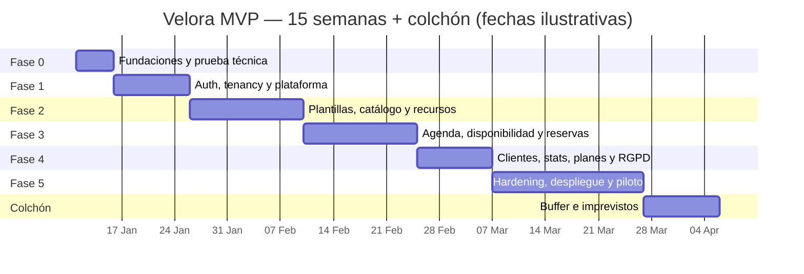

# ROADMAP.md — Fases, backlog, costes y lanzamiento

**Producto:** Velora (nombre de trabajo)  
**Documento:** plan de ejecución para aprobación  
**Versión:** 1.1  
**Estado:** Fase 0 y Fase 1 implementadas; Fase 2 pendiente  
**Cambios v1.1:** Auth.js, recursos físicos, plantillas sectoriales y multisede.

---

## 1. Enfoque

El MVP se construye en **seis fases**, con una duración orientativa de **15 semanas de trabajo efectivo** (13 de construcción + 2 de piloto) para una persona a tiempo completo, más un colchón de 2 semanas. Cada fase termina con una demo funcional, tests y criterios de salida.

La prioridad es llegar antes a un producto usable por un negocio real que a una plataforma completa. Todo lo que no sea necesario para que una peluquería reserve online y gestione su agenda queda fuera del MVP.

> **Regla de alcance:** si una función nueva no está en el backlog P0, no entra en el MVP. Se añade a P1/P2 con estimación y coste explícitos.

---

## 2. Supuestos de planificación

| Supuesto | Valor |
|---|---|
| Equipo | 1 desarrollador full-stack a tiempo completo; apoyo puntual de diseño/producto. |
| Jornada | 5 días/semana, 6–7 horas efectivas. |
| Duración | 15 semanas + 2 de colchón (13 de construcción + 2 de piloto). |
| Diseño | Sistema de componentes propio; no se encarga una identidad visual externa. |
| Contenido | Textos en español; no hay traducción. |
| Legal | Revisión externa de privacidad/DPA antes del lanzamiento. |
| Piloto | 1 negocio real, idealmente con 2–5 profesionales. |
| Infraestructura | VPS europeo + Docker Compose; sin Kubernetes. |
| Pagos | No se implementan. |

### 2.1 Estimación por tamaño

| Talla | Esfuerzo orientativo |
|---|---|
| S | ≤ 2 días |
| M | 3–5 días |
| L | 6–10 días |
| XL | > 10 días; se divide antes de empezar |

Las estimaciones son relativas y se recalibran al final de cada fase.

---

## 3. Fases

> Fechas ilustrativas: se fijarán al aprobar la propuesta y dependerán de la disponibilidad del equipo.



Las fechas exactas se fijarán al aprobar la propuesta. El diagrama muestra el orden y la duración relativa, no un compromiso de calendario.

---

### Fase 0 — Fundaciones y prueba técnica (1 semana) ✅

**Objetivo:** tener un esqueleto ejecutable con las decisiones críticas validadas.

> **Estado:** completada. El repositorio incluye Next.js, Prisma, migración con RLS y exclusion constraints, Auth.js, seed y pruebas de concurrencia.

**Entregables:**

- Repositorio, estructura de carpetas y convenciones.
- TypeScript estricto, ESLint, Prettier y CI básica.
- Docker Compose con PostgreSQL, Mailpit y MinIO.
- Validación de variables de entorno.
- Logger, manejo de errores y request ID.
- Esquema Prisma inicial con tablas globales y de negocio.
- Migración con RLS y prueba de aislamiento.
- Helper `withTenant` + tests.
- Seed de dos empresas y planes.
- Auth.js configurado con Google y enlace mágico de prueba.
- Layout base del panel.
- Prueba de concurrencia con `appointments` y exclusion constraint de profesional.
- Prueba de concurrencia con `resource_reservations` y exclusion constraint de recurso.
- ADR-001 a ADR-013 registrados.

**Criterios de salida:**

- [ ] `pnpm dev` levanta la app y los servicios.
- [ ] `pnpm test` y `pnpm typecheck` pasan.
- [ ] Dos tenants no se ven entre sí con RLS activo.
- [ ] 20 inserciones concurrentes en el mismo hueco dejan 1 éxito.
- [ ] 20 inserciones concurrentes en el mismo recurso dejan 1 éxito.
- [ ] El esquema se migra desde cero en CI.
- [ ] No hay código de módulos funcionales todavía.

**Riesgo principal:** que RLS + Prisma sea más costoso de lo previsto. Si aparece un bloqueo serio, se decide en esta fase entre RLS desde el inicio o aislamiento aplicativo + RLS en Fase 1.5, nunca se deja para el final.

---

### Fase 1 — Auth, tenancy y plataforma (2 semanas) ✅

**Objetivo:** un superadministrador puede crear una empresa y un propietario puede entrar y configurar lo básico.

> **Estado:** completada. Incluye invitaciones con token, RBAC, plataforma de empresas/planes, suspensión, configuración de negocio/sede/horario, publicación y auditoría. Los límites de plan y el bloqueo de la web pública se completarán cuando existan esos módulos.

**Entregables:**

- Auth.js: Google OAuth, enlace mágico, sesiones en base de datos.
- Invitaciones y aceptación de owner/profesional; sin contraseñas.
- RBAC y guards de servidor.
- Contexto de tenant y cambio de empresa/sede.
- Plataforma: listado, alta, detalle, suspensión y reactivación.
- Planes y suscripciones manuales.
- Configuración del negocio, sector y sede.
- Horario comercial.
- Slug, publicación y vista previa.
- Auditoría de acciones.
- Página de login y layout del panel.

**Criterios de salida:**

- [x] Se crea una empresa y el owner recibe la invitación.
- [x] El owner entra con Google o enlace mágico y acepta la invitación.
- [ ] Un profesional invitado ve solo su ámbito. El guard de ajustes ya lo bloquea; el filtrado fino de agenda llega con la Fase 3.
- [x] Un usuario de A no puede abrir recursos de B.
- [ ] Suspender bloquea las mutaciones del panel; la web pública aún no existe.
- [ ] Los límites de plan se validan en servidor. Se aplicarán al crear profesionales/sedes en la Fase 2.
- [x] Todo cambio sensible queda auditado.

**No incluye:** servicios, agenda, reservas.

---

### Fase 2 — Plantillas, catálogo, equipo y recursos (3 semanas)

**Objetivo:** el negocio puede configurar su oferta, su equipo, sus sedes y sus recursos, y existe una página pública en borrador.

**Entregables:**

- 7 plantillas sectoriales versionadas y aplicación merge.
- Vista previa de plantilla.
- CRUD de categorías y servicios.
- Variantes de precio y duración.
- Asignación de profesionales a servicios y sedes.
- CRUD de profesionales.
- Horarios semanales por profesional y sede.
- Excepciones, vacaciones y bloqueos.
- Tipos de recurso y recursos por sede.
- Requisitos de recursos por servicio.
- Subida y re-encode de imágenes.
- Página pública: perfil, servicios, equipo, horarios, dirección.
- Presets de tema y color principal.
- Vista previa y publicación.
- SEO básico y JSON-LD.

**Criterios de salida:**

- [ ] El owner aplica una plantilla y obtiene servicios y recursos coherentes.
- [ ] Aplicar la misma plantilla dos veces no duplica.
- [ ] El owner crea 3 servicios con variantes, 2 profesionales y 4 recursos.
- [ ] Cada profesional tiene sede, horario y servicios.
- [ ] Cada servicio que lo exige tiene requisitos de recurso.
- [ ] La página pública muestra precios, duración y equipo.
- [ ] La página no recibe reservas si no está publicada.
- [ ] Las imágenes se sirven desde R2 y están optimizadas.
- [ ] La disponibilidad aún no se muestra al cliente (Fase 3).

**Riesgo principal:** la edición de horarios y recursos en móvil. Se prueba en dispositivo real antes de cerrar la fase.

---

### Fase 3 — Agenda, disponibilidad y reservas (3 semanas)

**Objetivo:** el núcleo del producto. Una cita puede crearse desde el panel o desde la web pública, sin solapamientos.

**Entregables:**

- Motor de disponibilidad puro y testeado, con requisitos de recursos.
- API de disponibilidad.
- Agenda diaria y semanal.
- Vista por profesional, sede y recursos (P1).
- Crear/editar/cancelar cita.
- Cambiar servicio/profesional.
- Asignar y cambiar recursos.
- Bloqueos de profesional y de recurso.
- Reserva pública paso a paso.
- Transacción de reserva con lock de profesional y recursos, idempotencia y dos exclusion constraints.
- Upsert de cliente con deduplicación.
- Confirmación con token.
- Cancelación por enlace.
- Emails de confirmación, aviso al negocio y cancelación.
- Outbox y dispatcher.
- Pruebas de concurrencia de profesional y recurso.

**Criterios de salida:**

- [ ] Un cliente reserva desde el móvil sin cuenta.
- [ ] Solo se muestran horas libres.
- [ ] 20 reservas simultáneas al mismo hueco: 1 éxito, 19 `SLOT_TAKEN`.
- [ ] 20 reservas simultáneas a la misma cabina: 1 éxito, 19 `RESOURCE_TAKEN`.
- [ ] El owner ve la cita y sus recursos en la agenda.
- [ ] El cliente recibe confirmación y puede cancelar.
- [ ] El negocio recibe aviso.
- [ ] El recordatorio se programa y no se envía si se cancela.
- [ ] La agenda funciona en iOS Safari y Android Chrome.
- [ ] No hay datos de otras empresas en la respuesta pública.

**Riesgo principal:** zonas horarias, buffers y DST. Se cubren con tests antes de construir la UI.

---

### Fase 4 — Clientes, estadísticas, planes y RGPD (2 semanas)

**Objetivo:** el producto pasa de "reservas" a "gestión del negocio".

**Entregables:**

- Listado, búsqueda y ficha de clientes.
- Historial de citas y última visita.
- Deduplicación y fusión manual.
- Exportación CSV/JSON.
- Anonimización.
- Recordatorios y reintentos completos.
- Estadísticas básicas.
- Diferenciación ingreso estimado/cobro registrado.
- Límites de plan y overrides.
- Onboarding checklist.
- Consentimientos y retención.
- Atribución de Empresites.
- Herramientas de soporte.

**Criterios de salida:**

- [ ] El owner encuentra un cliente y ve su historial.
- [ ] No se duplican clientes por teléfono/email.
- [ ] La exportación solo incluye la empresa actual.
- [ ] La anonimización conserva métricas agregadas.
- [ ] El dashboard muestra las métricas del periodo.
- [ ] Un plan de 1 profesional bloquea el segundo.
- [ ] El onboarding guía hasta publicar.
- [ ] Los consentimientos quedan registrados.

---

### Fase 5 — Hardening, despliegue y piloto (4 semanas)

**Objetivo:** producto desplegado, monitorizado y probado con un negocio real.

**Entregables:**

- Suite E2E completa.
- Tests de seguridad y aislamiento.
- Auditoría de accesibilidad.
- Pruebas de carga de disponibilidad y reserva.
- Staging y producción.
- Backups automáticos y prueba de restauración.
- Monitorización, alertas y runbook.
- Documentación de soporte.
- Landing interna o página de presentación.
- Piloto con un negocio.
- Corrección de incidencias del piloto.

**Criterios de salida:**

- [ ] Producción accesible con TLS.
- [ ] Backup restaurado en un entorno limpio.
- [ ] Monitorización y alertas activas.
- [ ] E2E verde en staging.
- [ ] Lighthouse > 90 en la página pública.
- [ ] Un negocio piloto completa el onboarding y recibe reservas reales.
- [ ] No hay incidencias críticas en 2 semanas de piloto.
- [ ] Runbook de incidentes y soporte.

---

## 4. Backlog priorizado

### 4.1 P0 — Imprescindible para el MVP

| ID | Épica | Historia | Talla | Fase | Depende de |
|---|---|---|---|---|---|
| F0-01 | Fundaciones | Repositorio, lint, typecheck y CI | S | 0 | — |
| F0-02 | Fundaciones | Docker Compose con Postgres, Mailpit y MinIO | S | 0 | — |
| F0-03 | Fundaciones | Variables de entorno validadas y logger | S | 0 | F0-01 |
| F0-04 | Fundaciones | Esquema Prisma inicial y migraciones | M | 0 | F0-02 |
| F0-05 | Fundaciones | RLS, `withTenant` y tests de aislamiento | L | 0 | F0-04 |
| F0-06 | Fundaciones | Exclusion constraint de profesional | M | 0 | F0-04 |
| F0-07 | Fundaciones | Exclusion constraint de recurso | M | 0 | F0-04 |
| F0-08 | Fundaciones | Seed de dos empresas y planes | S | 0 | F0-04 |
| F0-09 | Fundaciones | Tokens de diseño y layout base | M | 0 | F0-01 |
| F0-10 | Auth | Spike de Auth.js con Google y enlace mágico | M | 0 | F0-01 |
| F1-01 | Auth | Auth.js, Google y enlace mágico | L | 1 | F0-10 |
| F1-02 | Auth | Invitación y aceptación de owner | M | 1 | F1-01 |
| F1-03 | Auth | Rate limit de acceso y enlace mágico | S | 1 | F1-01 |
| F1-04 | Auth | RBAC y guards de servidor | M | 1 | F1-01 |
| F1-05 | Tenancy | Contexto de tenant, empresa y sede | M | 1 | F1-04 |
| F1-06 | Plataforma | Listado, alta y detalle de empresas | L | 1 | F1-02 |
| F1-07 | Plataforma | Suspender/reactivar empresa | S | 1 | F1-06 |
| F1-08 | Plataforma | Planes, suscripciones y overrides | M | 1 | F1-06 |
| F1-09 | Negocio | Configuración del negocio, sector y sede | M | 1 | F1-05 |
| F1-10 | Negocio | Horario comercial por sede | S | 1 | F1-09 |
| F1-11 | Negocio | Slug, publicación y vista previa | M | 1 | F1-09 |
| F1-12 | Auditoría | Registro de acciones | M | 1 | F1-05 |
| F2-01 | Plantillas | Catálogo de 7 sectores y seed | M | 2 | F1-09 |
| F2-02 | Plantillas | Vista previa y aplicación merge idempotente | L | 2 | F2-01 |
| F2-03 | Catálogo | Categorías y servicios CRUD | M | 2 | F2-02 |
| F2-04 | Catálogo | Variantes de precio y duración | M | 2 | F2-03 |
| F2-05 | Equipo | Profesionales CRUD y sedes N:N | M | 2 | F1-09 |
| F2-06 | Equipo | Asignar servicios a profesionales | S | 2 | F2-03, F2-05 |
| F2-07 | Equipo | Horario semanal por profesional y sede | M | 2 | F2-05 |
| F2-08 | Equipo | Excepciones, vacaciones y bloqueos | L | 2 | F2-07 |
| F2-09 | Recursos | Tipos y recursos por sede | M | 2 | F1-09 |
| F2-10 | Recursos | Requisitos de recursos por servicio | M | 2 | F2-03, F2-09 |
| F2-11 | Recursos | Bloqueos de recurso | S | 2 | F2-09 |
| F2-12 | Medios | Subida y re-encode de imágenes | M | 2 | F0-02 |
| F2-13 | Web pública | Perfil, servicios, equipo y horarios | L | 2 | F2-03, F2-05 |
| F2-14 | Web pública | Tema, color y vista previa | M | 2 | F2-13 |
| F2-15 | Web pública | SEO y JSON-LD | S | 2 | F2-13 |
| F3-01 | Disponibilidad | Motor puro de slots con recursos | L | 3 | F2-07, F2-08, F2-10 |
| F3-02 | Disponibilidad | API de disponibilidad | M | 3 | F3-01 |
| F3-03 | Agenda | Vista diaria | L | 3 | F2-05 |
| F3-04 | Agenda | Vista semanal | L | 3 | F3-03 |
| F3-05 | Agenda | Crear/editar/cancelar cita | L | 3 | F3-02 |
| F3-06 | Agenda | Cambiar servicio/profesional | M | 3 | F3-05 |
| F3-07 | Agenda | Asignar y cambiar recursos | M | 3 | F3-05 |
| F3-08 | Agenda | Bloqueos de profesional y recurso | M | 3 | F3-05 |
| F3-09 | Agenda | Vista de recursos | M | 3 | F3-07 |
| F3-10 | Reserva | Wizard público | L | 3 | F3-02 |
| F3-11 | Reserva | Transacción, locks e idempotencia | L | 3 | F3-10 |
| F3-12 | Reserva | Upsert de cliente y deduplicación | M | 3 | F3-11 |
| F3-13 | Reserva | Confirmación y token | M | 3 | F3-11 |
| F3-14 | Reserva | Cancelación por enlace | M | 3 | F3-13 |
| F3-15 | Email | Outbox, dispatcher y plantillas | L | 3 | F3-11 |
| F3-16 | Email | Confirmación, aviso y cancelación | M | 3 | F3-15 |
| F4-01 | Clientes | Listado, búsqueda y ficha | L | 4 | F3-12 |
| F4-02 | Clientes | Historial y última visita | M | 4 | F4-01 |
| F4-03 | Clientes | Fusión manual de duplicados | M | 4 | F4-01 |
| F4-04 | Clientes | Exportación CSV/JSON | M | 4 | F4-01 |
| F4-05 | Clientes | Anonimización | M | 4 | F4-01 |
| F4-06 | Email | Recordatorio 24 h y reintentos | M | 4 | F3-15 |
| F4-07 | Stats | Dashboard básico | L | 4 | F3-05 |
| F4-08 | Stats | Estimado vs. cobrado | M | 4 | F4-07 |
| F4-09 | Planes | Límites y entitlements | M | 4 | F1-08 |
| F4-10 | Onboarding | Checklist y publicación guiada | M | 4 | F2-15 |
| F4-11 | RGPD | Consentimientos y retención | M | 4 | F4-05 |
| F4-12 | Empresites | Atribución externa | S | 4 | F1-06 |
| F4-13 | Soporte | Reenviar invitación y enlace de acceso | S | 4 | F1-06 |
| F5-01 | Calidad | E2E de flujos críticos | L | 5 | F3, F4 |
| F5-02 | Calidad | Tests de seguridad y aislamiento | M | 5 | F3, F4 |
| F5-03 | Calidad | Auditoría de accesibilidad | M | 5 | F2, F3 |
| F5-04 | Calidad | Pruebas de carga | M | 5 | F3 |
| F5-05 | Ops | Staging y producción | L | 5 | F0 |
| F5-06 | Ops | Backups y restauración | M | 5 | F5-05 |
| F5-07 | Ops | Monitorización y alertas | M | 5 | F5-05 |
| F5-08 | Ops | Runbook y documentación de soporte | M | 5 | F5-05 |
| F5-09 | Piloto | Onboarding y acompañamiento | L | 5 | F5-01..08 |

### 4.2 P1 — Deseable, fast follow

| ID | Historia | Talla | Fase |
|---|---|---|---|
| P1-01 | Arrastrar y soltar citas en agenda | L | Post-MVP |
| P1-02 | Archivo `.ics` para añadir al calendario | S | 3–5 |
| P1-03 | UI de permisos finos del profesional | M | 4 |
| P1-04 | Estadística de ocupación | S | 4 |
| P1-05 | Avisos de fin de prueba | S | 4 |
| P1-06 | Aviso de nueva versión de plantilla | S | 2 |
| P1-07 | Fusión de clientes con previsualización | M | 4 |
| P1-08 | Redirección 301 al cambiar slug | S | 2 |
| P1-09 | Exportación de citas | S | 4 |
| P1-10 | Búsqueda global en el panel | M | Post-MVP |

### 4.3 P2 — Futuro

| ID | Historia | Fase |
|---|---|---|
| P2-01 | Stripe: suscripciones y facturas | Post-MVP |
| P2-02 | SMS transaccional | Post-MVP |
| P2-03 | WhatsApp Business | Post-MVP |
| P2-04 | Reprogramación por el cliente | Post-MVP |
| P2-05 | Lista de espera | Post-MVP |
| P2-06 | Google Calendar | Post-MVP |
| P2-07 | Google Reserve | Post-MVP |
| P2-08 | Dominios personalizados | Post-MVP |
| P2-09 | PWA instalable | Post-MVP |
| P2-10 | Reseñas y valoraciones | Post-MVP |
| P2-11 | Bonos, paquetes y tarjetas regalo | Post-MVP |
| P2-12 | Fidelización y puntos | Post-MVP |
| P2-13 | Inventario y TPV | Post-MVP |
| P2-14 | Comisiones y propinas | Post-MVP |
| P2-15 | Multi-sede operativa | Post-MVP |
| P2-16 | Informes financieros avanzados | Post-MVP |
| P2-17 | Autoservicio de alta | Post-MVP |
| P2-18 | App móvil nativa | Post-MVP |
| P2-19 | Cuentas de cliente final | Post-MVP |
| P2-20 | Horarios y mantenimiento recurrente por recurso | Post-MVP |
| P2-21 | Capacidad > 1 por recurso | Post-MVP |
| P2-22 | Editor visual de plantillas | Post-MVP |
| P2-23 | Marketplace | **No planificado** |

---

## 5. Dependencias críticas

```text
F0-04 esquema
  └── F0-05 RLS
  └── F0-06 concurrencia profesional
  └── F0-07 concurrencia recurso
        └── F0-10 Auth.js
              └── F1 auth/tenancy/plataforma
                    └── F2 plantillas/catálogo/equipo/recursos
                          └── F3 disponibilidad + recursos
                                └── F3 reserva
                                      └── F4 clientes/emails/stats
                                            └── F5 piloto
```

- Sin RLS y concurrencia de profesional y recurso probadas en Fase 0, no se avanza a Fase 1.
- Sin Auth.js funcionando con Google y enlace mágico, no se construye el panel.
- Sin plantillas y requisitos de recursos, no se construye la disponibilidad.
- Sin motor de disponibilidad testeado, no se construye la UI de reserva.
- Sin outbox, no se envía ningún email desde la transacción de reserva.
- Sin backups probados, no se abre el piloto.

---

## 6. Riesgos de calendario

| Riesgo | Prob. | Impacto | Mitigación |
|---|---|---|---|
| RLS + Prisma cuesta más de lo previsto | Media | Alto | Prueba en Fase 0; fallback documentado. |
| Zonas horarias/DST generan bugs | Alta | Alto | Tests antes de UI; librería probada. |
| La agenda móvil requiere rediseño | Media | Medio | Prototipo en Fase 2; pruebas reales. |
| La concurrencia de recursos complica la reserva | Media | Alto | Prueba en Fase 0; constraints y tests antes de la UI. |
| Las plantillas duplican o pisan datos | Media | Medio | Merge idempotente, claves estables y tests. |
| Google OAuth o el email fallan | Media | Alto | Enlace mágico alternativo, proveedor de email y monitorización. |
| El proveedor de email complica la entrega | Media | Medio | Adaptador y proveedor alternativo. |
| El piloto pide funciones fuera de alcance | Alta | Alto | Backlog P0 cerrado; P1/P2 con coste. |
| Baja disponibilidad del desarrollador | Media | Alto | Colchón de 2 semanas; fases independientes. |
| Legal/DPA se retrasa | Media | Alto | Iniciar revisión en Fase 1, no en Fase 5. |
| Migración de datos del piloto | Baja | Medio | Importación CSV manual; no bloquea MVP. |

---

## 7. Plan de piloto y lanzamiento

### 7.1 Antes del piloto

- [ ] Producto desplegado en staging.
- [ ] Backup restaurado con éxito.
- [ ] Flujo E2E verde.
- [ ] Textos legales y DPA revisados.
- [ ] Correo con SPF/DKIM/DMARC.
- [ ] Monitorización y alertas.
- [ ] Runbook de soporte.
- [ ] Negocio piloto identificado y con datos reales preparados.

### 7.2 Piloto (2 semanas)

- Onboarding acompañado.
- Aplicación de plantilla y ajuste de servicios, equipo, recursos y horarios.
- Publicación de la página.
- Primeras reservas reales, incluidas citas con cabina/camilla.
- Revisión diaria de incidencias.
- Encuesta al propietario y a 5 clientes.
- Medición de:
  - Tiempo de onboarding.
  - Reservas online.
  - Errores de disponibilidad.
  - Conflictos de recursos.
  - Emails entregados.
  - Satisfacción.

### 7.3 Criterios de lanzamiento

**Producto:**

- [ ] 10 reservas reales sin doble reserva de profesional.
- [ ] 0 dobles ocupaciones de cabina/camilla.
- [ ] 0 incidencias críticas en 2 semanas.
- [ ] Onboarding < 30 minutos con ayuda.
- [ ] Plantilla aplicada y servicios/recursos editados.
- [ ] Flujo móvil completo.
- [ ] Cancelación y recordatorio funcionando.

**Seguridad:**

- [ ] Tests de aislamiento verdes.
- [ ] Tests de concurrencia de profesional y recurso verdes.
- [ ] Auth.js con Google y enlace mágico probado.
- [ ] Sin secretos en el repositorio; credenciales Google propias de Velora.
- [ ] Rate limiting activo.
- [ ] Backups y restauración probados.
- [ ] Revisión de dependencias.

**Legal:**

- [ ] Política de privacidad.
- [ ] Términos de servicio.
- [ ] DPA con el negocio.
- [ ] Registro de actividades de tratamiento.
- [ ] Política de cookies.
- [ ] Subencargados identificados.

**Operación:**

- [ ] Monitorización y alertas.
- [ ] Runbook de incidentes.
- [ ] Soporte por email.
- [ ] Documentación de usuario.
- [ ] Proceso de alta y baja.

### 7.4 Go/No-Go

El lanzamiento se pospone si:

- Hay una fuga de datos o un fallo de aislamiento.
- Se producen dobles reservas de profesional o de recurso en pruebas.
- No se puede restaurar un backup.
- Auth.js o el enlace mágico no funcionan de forma fiable.
- El flujo de reserva falla en un dispositivo móvil mayoritario.
- No hay DPA ni política de privacidad.
- El piloto no puede operar sin asistencia constante.

---

## 8. Costes de infraestructura y servicios

> Cifras orientativas en EUR, sin IVA, a precios de referencia. Deben confirmarse con las tarifas vigentes antes de contratar. No incluyen soporte, marketing, legal ni tiempo de desarrollo.

### 8.1 Escenario MVP (hasta ~100 empresas)

| Concepto | Proveedor | Coste mensual estimado | Notas |
|---|---|---:|---|
| VPS producción | Hetzner CX32 (4 vCPU, 8 GB) | 9–12 € | Incluye backups y IPv4 aproximados. |
| VPS staging | Hetzner CX22 (2 vCPU, 4 GB) | 6–8 € | Opcional; puede ir en el mismo VPS con límites. |
| Dominio | Registrador | ~1 € | 12–15 €/año. |
| Almacenamiento | Cloudflare R2 | 0–3 € | 10 GB gratis; egress gratis. |
| Email | Brevo | 0–15 € | Free tier o plan inicial. |
| Monitorización | Sentry / Better Stack / UptimeRobot | 0–10 € | Free tiers suficientes al inicio. |
| Backups | R2 / Storage Box | 1–3 € | Copias cifradas. |
| CI | GitHub Actions | 0 € | Free tier. |
| **Total** | | **17–52 €/mes** | Sin staging: 11–44 €/mes. |

### 8.2 Escenario 100–500 empresas

| Concepto | Coste mensual estimado |
|---|---:|
| VPS producción más grande | 20–40 € |
| PostgreSQL gestionado (opcional) | 20–60 € |
| Staging | 8–15 € |
| R2 | 3–10 € |
| Email | 15–50 € |
| Monitorización | 10–30 € |
| **Total** | **76–205 €/mes** |

### 8.3 Alternativa gestionada

| Concepto | Coste mensual estimado |
|---|---:|
| Vercel Pro | ~20 € |
| Neon Launch / Postgres gestionado | ~20–60 € |
| R2 + Brevo + monitorización | 10–40 € |
| **Total** | **50–120 €/mes** |

La opción VPS es más barata y portable; la gestionada reduce operación. Se decide en Fase 0 según el tiempo disponible para operar.

### 8.4 Costes variables futuros

| Servicio | Coste orientativo | Nota |
|---|---|---|
| Email transaccional | 0,001–0,002 €/email | Depende del proveedor y volumen. |
| SMS España | 0,07–0,12 €/SMS | Verificar proveedor y número. |
| WhatsApp Business | 0,05–0,12 €/conversación | Varía por país y categoría. |
| Stripe | ~1,5 % + 0,25 € por cobro | Tarifa orientativa; no se usa en MVP. |
| Dominio personalizado | 10–20 €/año | Coste repercutible al cliente. |

### 8.5 Costes únicos iniciales

| Concepto | Coste orientativo |
|---|---:|
| Dominio y marca | 100–500 € |
| Revisión legal (privacidad, términos, DPA) | 500–1.500 € |
| Diseño de logo/identidad (opcional) | 300–1.500 € |
| Alta de proveedores y cuentas | 0–100 € |
| **Total** | **900–3.500 €** |

No se incluye el coste del tiempo de desarrollo ni el soporte.

Referencias de precios: [Hetzner Cloud](https://www.hetzner.com/cloud/), [Cloudflare R2](https://developers.cloudflare.com/r2/pricing/) y [Brevo](https://www.brevo.com/pricing/). Confirmar tarifas vigentes antes de contratar.

Recursos y plantillas no cambian el coste de infraestructura de forma significativa; sí añaden tiempo de desarrollo y pruebas de concurrencia.

### 8.6 Unit economics a 100 empresas

Suponiendo un ARPU (ingreso medio por usuario) de 30 €/mes:

- Ingresos: 3.000 €/mes.
- Infraestructura: 30–80 €/mes.
- Email: 10–30 €/mes.
- Margen bruto de infraestructura: > 95 %.
- El coste real es soporte y adquisición, no la infraestructura.

---

## 9. Post-MVP

### 9.1 Primeros 3 meses después del lanzamiento

- Stripe y facturación automática.
- SMS transaccional y preferencias de comunicación.
- Reprogramación por el cliente.
- Drag & drop en agenda.
- `.ics` y enlaces de calendario.
- Lista de espera básica.
- Mejoras de onboarding y plantillas.
- Aviso de nueva versión de plantilla.
- Panel de uso y límites.

### 9.2 3–6 meses

- Google Calendar.
- Dominios personalizados.
- PWA instalable.
- Reseñas y valoraciones.
- Bonos, paquetes y tarjetas regalo.
- Fidelización.
- Multi-sede operativa.
- Horarios y mantenimiento recurrente por recurso.
- Capacidad > 1 por recurso.
- Editor visual de plantillas.
- Importación CSV de clientes y servicios.

### 9.3 6–12 meses

- TPV y caja.
- Inventario.
- Comisiones y propinas.
- Informes financieros avanzados.
- WhatsApp Business.
- Google Reserve si se cumplen requisitos.
- App móvil nativa si la demanda lo justifica.
- Autoservicio de alta.

Cada fase posterior debe validarse con datos de uso y disposición a pagar, no por paridad con la competencia.

---

## 10. Definition of Done

Una historia está terminada cuando:

- [ ] Cumple los criterios de aceptación.
- [ ] Tiene tests unitarios o de integración.
- [ ] Pasa lint, typecheck y build.
- [ ] Respeta el aislamiento por empresa.
- [ ] Valida permisos en servidor.
- [ ] Tiene estados de carga, vacío y error.
- [ ] Es accesible con teclado y lector de pantalla.
- [ ] Funciona en móvil.
- [ ] Registra auditoría si es una acción sensible.
- [ ] Si toca recursos, valida exclusividad y liberación.
- [ ] Si toca plantillas, es idempotente y no sobrescribe datos.
- [ ] Si toca auth, usa Auth.js y no añade contraseñas propias.
- [ ] Está documentada si cambia un flujo o una decisión.
- [ ] No introduce datos personales en logs.

---

## 11. Puertas de aprobación

| Puerta | Cuándo | Qué se revisa |
|---|---|---|
| G0 | Antes de Fase 0 | Esta propuesta, decisiones D1–D11, alcance y costes. |
| G1 | Fin de Fase 0 | RLS, concurrencia de profesional y recurso, esquema, CI y Docker. |
| G2 | Fin de Fase 1 | Auth.js, alta de empresa, permisos y suspensión. |
| G3 | Fin de Fase 2 | Plantillas, catálogo, equipo, recursos, horarios y página pública. |
| G4 | Fin de Fase 3 | Reserva real, concurrencia de profesional y recurso, agenda y emails. |
| G5 | Fin de Fase 4 | Clientes, stats, planes y RGPD. |
| G6 | Fin de Fase 5 | Piloto, seguridad, backups y lanzamiento. |

Cada puerta puede decidir: continuar, corregir alcance o parar. No se acumulan fases sin validación.

---

## 12. Próximo paso

1. Revisar [PRODUCT.md](PRODUCT.md), [ARCHITECTURE.md](ARCHITECTURE.md) y este documento.
2. Resolver las decisiones abiertas del [README](../README.md#9-decisiones-pendientes-de-aprobación).
3. Aprobar o corregir el alcance.
4. Iniciar la Fase 0 solo tras la aprobación.

**No se ha implementado código de producto.**
