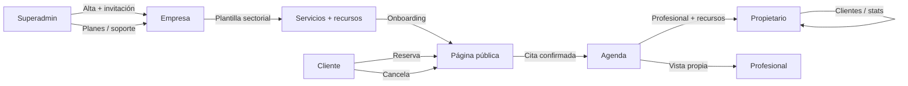
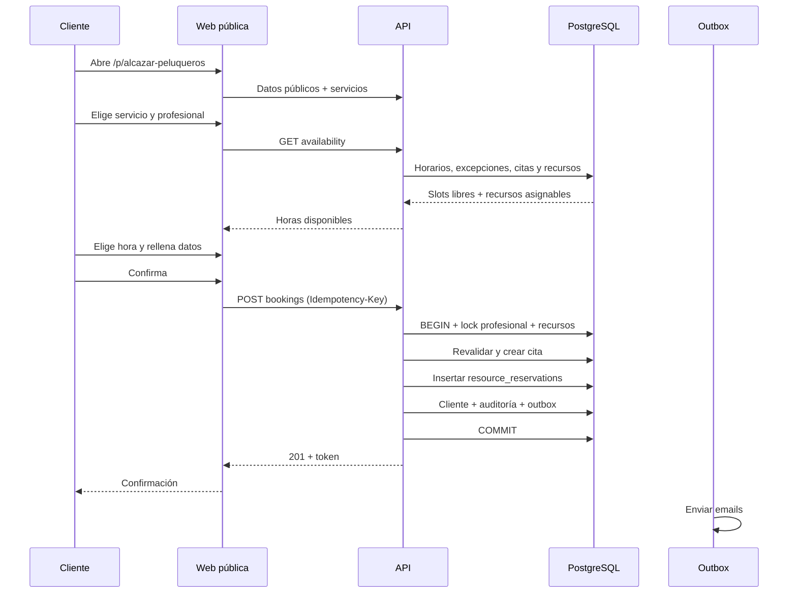

# USER-FLOWS.md — Flujos de usuario y criterios de aceptación

**Producto:** Velora (nombre de trabajo)  
**Documento:** flujos funcionales para aprobación  
**Versión:** 1.1  
**Estado:** diseño; Fase 0 implementada  
**Cambios v1.1:** Auth.js, recursos físicos, plantillas sectoriales y multisede.

---

## 1. Cómo leer este documento

Cada flujo incluye:

- **Actor** y **precondiciones**.
- **Camino principal**.
- **Caminos alternativos y errores**.
- **Criterios de aceptación** verificables.

Los identificadores `FR-*` se corresponden con [PRODUCT.md](PRODUCT.md#7-requisitos-funcionales).

---

## 2. Mapa de flujos

---

## 3. Flujo F1 — Alta de una empresa por superadministrador

**Actor:** superadministrador  
**Precondiciones:** sesión con `is_superadmin`; plan activo disponible.  
**Requisitos:** A1, A3, A4, C10, C12, N1.

### Camino principal

1. Entra en `/platform/empresas` y pulsa **Nueva empresa**.
2. Introduce:
   - Nombre comercial.
   - Slug público (`alcazar-peluqueros`).
   - Email del propietario.
   - Sector principal (barbería, peluquería, manicura, spa, cejas/pestañas, estética, masajes).
   - Sede inicial: nombre, dirección y zona horaria.
   - Plan inicial.
   - Días de prueba.
   - Origen comercial opcional (Empresites: ID, URL, estado).
3. El sistema valida el slug, el email y la sede.
4. Se crea la empresa en estado `active` con página en borrador, una sede activa y el sector principal.
5. Se crea la suscripción en `trialing` o `active` según el plan.
6. Se crea una invitación para el propietario con token de un solo uso.
7. Se encola el email de invitación con un enlace a `/invitacion/[token]`.
8. La plataforma muestra la empresa creada y el estado de la invitación.

### Alternativas y errores

- **Slug ocupado:** se sugieren variantes (`alcazar-peluqueros-2`, `alcazar-madrid`).
- **Email ya existente:** se reutiliza el usuario y se crea una nueva membership; no se duplica la identidad.
- **Email inválido:** error de validación; no se crea nada.
- **Fallo de email:** la empresa se crea igualmente; la invitación queda `pending` y se puede reenviar.
- **Empresites no disponible:** el alta funciona; los campos de atribución son opcionales.

### Criterios de aceptación

- [ ] Se crea empresa, sede, sector, suscripción e invitación en una sola transacción.
- [ ] El slug es único y cumple el formato.
- [ ] El propietario recibe un email con enlace de invitación.
- [ ] La empresa no es pública hasta que el propietario publique la página.
- [ ] El superadministrador puede reenviar la invitación.
- [ ] La acción queda registrada en auditoría.

---

## 4. Flujo F2 — Activación del propietario

**Actor:** propietario invitado  
**Precondiciones:** invitación válida y no expirada.  
**Requisitos:** B1–B4, B10, O1.

### Camino principal

1. El propietario abre el enlace del email.
2. El sistema valida el token (hash, caducidad, no usado) y muestra el nombre de la empresa y el email invitado.
3. El propietario elige **Continuar con Google** o **Recibir enlace mágico**.
4. Auth.js completa el inicio de sesión y devuelve el control a Velora.
5. El sistema comprueba que el email autenticado coincide con el de la invitación.
6. El propietario acepta los términos y la política de privacidad.
7. Se crea/actualiza el usuario y se crea la membership `owner` con la sede inicial.
8. Se invalida el token de invitación.
9. Se redirige al onboarding.

### Alternativas y errores

- **Token caducado:** se ofrece solicitar una nueva invitación.
- **Token ya usado:** se redirige a `/login`.
- **Email distinto:** se rechaza la invitación y se muestra el email esperado.
- **Sin invitación ni membership:** Auth.js puede autenticar, pero el panel muestra “sin acceso” y no revela datos.
- **Google no disponible:** se usa el enlace mágico.
- **Enlace mágico caducado:** se solicita uno nuevo.

### Criterios de aceptación

- [ ] El token de invitación es de un solo uso y caduca a los 7 días.
- [ ] No se crea ni se guarda ninguna contraseña.
- [ ] El email autenticado debe coincidir con el invitado.
- [ ] La membership queda `active` con rol `owner` y la sede inicial.
- [ ] El usuario puede entrar al panel con Google o enlace mágico.
- [ ] Se registra el método de acceso y la aceptación de términos.

---

## 5. Flujo F3 — Onboarding del negocio

**Actor:** propietario  
**Precondiciones:** sesión activa; empresa en borrador.  
**Requisitos:** O1, O2, O3, C1–C12, D1–D10, E1–E10, F1–F12, P1–P6, Q1–Q7.

### Camino principal

1. El dashboard muestra una checklist:
   - Datos del negocio.
   - Sector y plantilla aplicada.
   - Al menos 3 servicios.
   - Al menos 1 profesional.
   - Recursos necesarios para los servicios que los exigen.
   - Horario comercial.
   - Horario del profesional.
   - Página publicada.
2. **Paso 1 — Negocio:** nombre, dirección, teléfono, email, zona horaria, logo y color.
3. **Paso 2 — Actividad:** elige el sector principal; ve la vista previa de la plantilla y aplica los datos iniciales.
4. **Paso 3 — Servicios:** revisa categorías, servicios y variantes creados; añade o edita.
5. **Paso 4 — Equipo:** añade profesionales; asigna servicios y sedes; invita a los que tendrán login.
6. **Paso 5 — Recursos:** revisa tipos y recursos sugeridos (cabinas, camillas, puestos, sillones); ajusta cantidades.
7. **Paso 6 — Horarios:** define horario comercial por sede; copia a profesionales; añade excepciones.
8. **Paso 7 — Página:** previsualiza la web pública; edita textos, fotos y slug.
9. **Paso 8 — Publicar:** valida servicios, profesionales, recursos, horarios y sede; publica.
10. Se muestra la URL y un botón para copiar/compartir y descargar QR.

### Alternativas y errores

- **Falta un requisito:** la publicación se bloquea con un mensaje que indica qué falta.
- **Servicio sin profesional:** se avisa; no se ofrece online hasta asignarlo.
- **Servicio con recurso inexistente:** se avisa; no se ofrece online hasta crear el recurso o quitar el requisito.
- **Plantilla ya aplicada:** se muestra “ya aplicada” y no se duplica.
- **Horario vacío:** no se generan slots; se muestra ayuda.
- **Slug no disponible:** se sugiere otro.
- **El propietario quiere publicar sin fotos:** permitido; se usa un placeholder.

### Criterios de aceptación

- [ ] Se puede completar el onboarding en menos de 30 minutos.
- [ ] La plantilla crea servicios, categorías y recursos sin duplicar datos.
- [ ] La checklist se actualiza en tiempo real.
- [ ] La vista previa refleja los cambios guardados.
- [ ] La página no recibe reservas hasta publicarse.
- [ ] Al publicar, el slug queda accesible en `/p/[slug]`.
- [ ] Se puede volver atrás sin perder datos.

---

## 6. Flujo F4 — Configurar servicios y variantes

**Actor:** propietario  
**Precondiciones:** sesión de owner.  
**Requisitos:** D1–D7.

### Camino principal

1. Entra en **Servicios**.
2. Crea una categoría (`Caballero`, `Color`, `Manicura`).
3. Pulsa **Nuevo servicio**.
4. Introduce nombre, descripción, categoría, precio, duración y margen.
5. Añade variantes opcionales:
   - `Corte + barba` — 45 min — 19,50 €.
   - `Corte + barba + lavado` — 60 min — 24 €.
6. Asigna profesionales que pueden realizarlo.
7. Añade los **recursos necesarios**:
   - Cabina/camilla: cantidad 1.
   - Recurso concreto opcional.
8. Marca `Reservable online`.
9. Guarda y comprueba que aparece en la página pública.

### Reglas

- La duración debe ser > 0 y ≤ 24 h.
- El margen debe ser ≥ 0.
- El precio debe ser ≥ 0.
- Una variante no puede tener nombre duplicado dentro del servicio.
- Si un servicio no tiene profesionales, no se ofrece online.
- Si un servicio exige un recurso que no existe en la sede, no se ofrece online.
- Si se desactiva un servicio, deja de ofrecerse pero las citas existentes se conservan.

### Criterios de aceptación

- [ ] El servicio aparece en el catálogo y en la página pública si está activo y online.
- [ ] La variante elegida determina precio y duración de la cita.
- [ ] No se puede asignar un profesional inactivo.
- [ ] Los cambios se reflejan en la disponibilidad.
- [ ] Un servicio con requisito de cabina no se ofrece si no hay cabina libre.

---

## 7. Flujo F5 — Configurar equipo y horarios

**Actor:** propietario  
**Precondiciones:** servicios creados.  
**Requisitos:** E1–E10, F1–F12, B6.

### Camino principal

1. Entra en **Equipo** y pulsa **Añadir profesional**.
2. Introduce nombre, título, bio, foto, color y servicios.
3. Asigna una o varias sedes.
4. Decide si tendrá acceso al panel:
   - **Sí:** introduce email y se envía invitación.
   - **No:** se crea el profesional sin usuario.
5. Configura su horario semanal **por sede**:
   - Lunes a viernes, 09:00–14:00 y 16:00–20:00.
   - Sábado, 09:00–14:00.
6. Añade vacaciones, días libres o bloqueos.
7. Guarda.

### Alternativas y errores

- **Solapamiento de horarios:** se permite si son intervalos distintos; se valida que no se crucen.
- **Horario fuera del horario comercial:** se avisa; la disponibilidad efectiva es la intersección.
- **Profesional sin servicios:** se guarda, pero no recibe reservas online.
- **Profesional sin sede:** se guarda, pero no se ofrece online hasta asignarle una.
- **Invitación pendiente:** el profesional aparece como inactivo hasta aceptar, pero puede recibir citas manuales si el owner lo decide.

### Criterios de aceptación

- [ ] El horario del profesional por sede se respeta en la disponibilidad.
- [ ] Las vacaciones eliminan los slots del rango.
- [ ] El profesional solo recibe servicios que realiza.
- [ ] El owner puede activar/desactivar a un profesional.
- [ ] El profesional invitado puede entrar y ve solo sus sedes y su agenda.

---

## 8. Flujo F6 — Agenda diaria del propietario

**Actor:** propietario  
**Precondiciones:** empresa publicada, profesionales y servicios.  
**Requisitos:** G1–G17.

### Camino principal

1. Al entrar en `/app`, la agenda del día es la pantalla principal.
2. Ve columnas por profesional y citas con hora, cliente, servicio, recursos y estado.
3. Puede:
   - Cambiar entre día y semana.
   - Filtrar por profesional o sede.
   - Crear una cita con el botón **+**.
   - Pulsar una cita para ver detalles.
   - Editar, cambiar de profesional, cancelar o marcar como completada.
   - Ver y cambiar los recursos asignados si hay alternativas.
   - Marcar cobro manual.
4. Puede abrir la **vista de recursos** para ver cabinas, camillas o puestos ocupados.
5. Los cambios se reflejan de inmediato y se registran en auditoría.

### Alternativas y errores

- **Conflicto de horario:** se muestra el conflicto y no se guarda.
- **Conflicto de recurso:** se muestra la cabina/camilla ocupada y se ofrecen alternativas.
- **Profesional no cualificado:** no aparece en el selector.
- **Cita fuera del horario:** se avisa; el owner puede forzar solo si tiene permiso (no en MVP).
- **Cita ya cancelada:** no se puede completar.
- **Error de red:** se mantiene el formulario y se permite reintentar.

### Criterios de aceptación

- [ ] La agenda carga en < 2 s con 8 profesionales y 100 citas/día.
- [ ] Crear una cita valida horario, servicio, profesional, recursos y solapamiento.
- [ ] Cambiar de profesional revalida la disponibilidad.
- [ ] Cambiar de recurso revalida la ocupación.
- [ ] Cancelar libera el hueco y los recursos, y notifica.
- [ ] Completar una cita actualiza estadísticas.
- [ ] El cobro manual no se confunde con un pago online.

---

## 9. Flujo F7 — Agenda del profesional

**Actor:** profesional con acceso  
**Precondiciones:** membership activa; permisos configurados.  
**Requisitos:** B5, B6, B7, E6, E9, G3.

### Camino principal

1. El profesional inicia sesión con Google o enlace mágico.
2. Ve solo sus sedes asignadas y su agenda del día/semana.
3. Puede consultar sus citas, los recursos asignados y los datos necesarios del cliente.
4. Si tiene permiso, crea una cita para sí mismo.
5. Si tiene permiso, edita/cancela sus citas y cambia recursos disponibles.
6. No ve la agenda completa ni la base de clientes.

### Alternativas y errores

- **Intenta acceder a una cita ajena por URL:** recibe 403.
- **Intenta ver un cliente sin cita propia:** recibe 403.
- **Permiso desactivado:** el botón no aparece y el servidor rechaza la acción.

### Criterios de aceptación

- [ ] El filtro por profesional y sede es obligatorio a nivel de servidor, no solo visual.
- [ ] El profesional no puede acceder a datos de otra empresa.
- [ ] El owner puede cambiar los permisos.
- [ ] El profesional sin login no bloquea la operación del negocio.

---

## 10. Flujo F8 — Crear cita manual

**Actor:** propietario o profesional autorizado  
**Precondiciones:** cliente, servicio y profesional disponibles.  
**Requisitos:** G4, G5, G6, G10, G15.

### Camino principal

1. Pulsa **Nueva cita**.
2. Busca o crea un cliente.
3. Selecciona sede, servicio y variante.
4. Selecciona profesional (solo los que realizan el servicio en esa sede).
5. Selecciona fecha y hora.
6. El sistema muestra disponibilidad, valida y propone los recursos necesarios.
7. El owner puede cambiar los recursos si hay alternativas libres.
8. Añade notas internas si procede.
9. Guarda.
10. La cita aparece en la agenda como `confirmed`.
11. Se envía confirmación al cliente si tiene email y el negocio lo permite.

### Alternativas y errores

- **Cliente duplicado:** se sugiere la ficha existente por teléfono/email.
- **Hueco ocupado:** se muestran alternativas.
- **Recurso ocupado:** se muestra la cabina/camilla ocupada y se ofrecen alternativas.
- **Servicio sin recurso configurado:** se bloquea y se enlaza a Recursos.
- **Fuera de horario:** se bloquea.
- **Sin email:** se guarda; no se envía confirmación.
- **Cita en el pasado:** se permite solo como registro histórico si el owner lo confirma.

### Criterios de aceptación

- [ ] No se puede crear una cita solapada.
- [ ] No se puede crear una cita sin los recursos requeridos.
- [ ] El precio se congela en la cita.
- [ ] El cliente se reutiliza si ya existe.
- [ ] La cita queda auditada.
- [ ] La confirmación se encola, no se envía de forma síncrona.

---

## 11. Flujo F9 — Reserva online del cliente final

**Actor:** cliente final  
**Precondiciones:** empresa publicada, sede activa, servicio online, profesional con horario y recursos configurados si el servicio los exige.  
**Requisitos:** H1–H10, H16–H18, P1–P6.

### Camino principal

### Pasos detallados

1. El cliente abre la página pública en el móvil.
2. Ve servicios, precios, duración, equipo, horarios y dirección.
3. Pulsa **Reservar**.
4. Selecciona un servicio (y variante si existe).
5. Selecciona un profesional o **Cualquiera disponible**.
6. Selecciona una fecha dentro del horizonte permitido.
7. El sistema muestra solo horas libres.
8. Selecciona una hora.
9. Introduce nombre, teléfono, email, notas opcionales.
10. Acepta la política de privacidad; el consentimiento de marketing es opcional y desmarcado.
11. Revisa el resumen: servicio, profesional, recursos asignados, fecha, duración, precio y política de cancelación.
12. Confirma.
13. El servidor revalida profesional y recursos, y crea la cita.
14. Se muestra la confirmación con:
    - Código de reserva.
    - Fecha, hora, profesional, recursos y dirección.
    - Enlace para añadir al calendario.
    - Enlace para cancelar.
15. Se envían los emails de confirmación y aviso al negocio.

### Alternativas y errores

- **No hay disponibilidad:** se sugiere otra fecha o profesional.
- **El hueco se ocupa mientras rellena:** al confirmar recibe `SLOT_TAKEN`; se muestran alternativas sin perder los datos.
- **La cabina/camilla se ocupa mientras rellena:** recibe `RESOURCE_TAKEN`; se muestran alternativas reales.
- **Servicio sin recurso configurado:** no aparece como reservable y se avisa al negocio.
- **Doble clic:** la idempotencia devuelve la misma cita.
- **Email inválido:** error de validación; no se envía.
- **Teléfono inválido:** error; se normaliza a E.164.
- **Servicio desactivado entre medias:** `SERVICE_NOT_AVAILABLE`.
- **Empresa suspendida:** `BUSINESS_SUSPENDED`.
- **Sin consentimiento de privacidad:** no se puede continuar.
- **Cliente ya existente:** se reutiliza la ficha; no se duplica.
- **Fallo de email:** la cita se crea; el email se reintenta.

### Criterios de aceptación

- [ ] El flujo completo se completa en menos de 2 minutos en un móvil.
- [ ] No se muestran horas ocupadas ni recursos ocupados.
- [ ] No se requiere cuenta ni contraseña.
- [ ] La cita se crea una sola vez aunque el cliente pulse dos veces.
- [ ] El cliente recibe confirmación por email.
- [ ] El negocio recibe aviso.
- [ ] El enlace de cancelación funciona sin login.
- [ ] El resumen muestra los recursos asignados.
- [ ] El flujo es accesible con teclado y lector de pantalla.

---

## 12. Flujo F10 — El hueco se ocupa durante la reserva

**Actor:** cliente final  
**Precondiciones:** dos clientes eligen el mismo hueco o el mismo recurso.  
**Requisitos:** H9, H18, G4, técnica de concurrencia.

### Secuencia

1. Cliente A y cliente B ven el mismo hueco.
2. A confirma primero: transacción, lock de profesional y recursos, inserción, commit.
3. B confirma después:
   - La revalidación detecta el solapamiento de profesional o de recurso, o la constraint lo rechaza.
   - La API devuelve `409 SLOT_TAKEN` o `409 RESOURCE_TAKEN`.
4. La UI de B mantiene los datos y muestra:
   - "Ese horario acaba de ocuparse."
   - Alternativas del mismo día/profesional.
5. B elige otra hora y confirma.

### Criterios de aceptación

- [ ] Solo se crea una cita.
- [ ] B recibe un error claro, no un 500.
- [ ] B no pierde los datos introducidos.
- [ ] Las alternativas son reales y se recalculan.
- [ ] La prueba automática con 20 peticiones concurrentes deja 1 éxito y 19 conflictos.
- [ ] La prueba con dos profesionales y una sola cabina deja 1 éxito.

---

## 13. Flujo F11 — Cancelación por el cliente

**Actor:** cliente final  
**Precondiciones:** cita confirmada; enlace con token válido.  
**Requisitos:** H8, J3, G7.

### Camino principal

1. El cliente abre el enlace del email.
2. Ve el detalle de la cita.
3. Pulsa **Cancelar cita**.
4. El sistema comprueba la política:
   - Si faltan más horas que el corte, permite cancelar.
   - Si está dentro del corte, muestra que debe contactar con el negocio.
5. El cliente confirma y puede indicar un motivo.
6. La cita pasa a `cancelled`.
7. Se libera el hueco del profesional y las reservas de recursos.
8. Se envían emails al cliente y al negocio.
9. Se muestra confirmación de cancelación.

### Alternativas y errores

- **Token inválido/caducado:** se pide contactar con el negocio.
- **Cita ya cancelada:** se muestra el estado; no se duplica el email.
- **Cita completada:** no se puede cancelar.
- **Fuera de plazo:** no se permite; se muestra el teléfono del negocio.
- **Doble clic:** idempotente.

### Criterios de aceptación

- [ ] La cancelación respeta la política configurada.
- [ ] El hueco y los recursos vuelven a estar disponibles.
- [ ] El negocio recibe aviso.
- [ ] La acción queda auditada con `cancelled_by = client`.
- [ ] No se puede cancelar una cita de otra empresa con un token manipulado.

---

## 14. Flujo F12 — Cancelación por el negocio

**Actor:** propietario o profesional autorizado  
**Precondiciones:** cita confirmada.  
**Requisitos:** G7, J3.

1. Abre la cita en la agenda.
2. Pulsa **Cancelar**.
3. Indica motivo (opcional pero recomendado).
4. Confirma.
5. La cita pasa a `cancelled`.
6. Se libera el hueco y los recursos.
7. Se envía email al cliente con el motivo y el contacto del negocio.
8. Se registra en auditoría.

**Criterios de aceptación:**

- [ ] El cliente recibe aviso.
- [ ] El hueco y los recursos se liberan.
- [ ] El motivo se guarda.
- [ ] No se puede cancelar una cita ya completada sin cambiar su estado primero.

---

## 15. Flujo F13 — Bloqueo de agenda y vacaciones

**Actor:** propietario  
**Precondiciones:** profesional o recurso, y fechas.  
**Requisitos:** E4, E5, G8, G17, F3, F12.

### Camino principal

1. Entra en **Agenda**, **Equipo** o **Recursos**.
2. Pulsa **Bloquear intervalo**.
3. Elige profesional, recurso o todo el negocio; fecha/hora de inicio y fin; categoría y motivo.
4. El sistema comprueba que no haya citas en ese intervalo.
5. Si hay citas, muestra conflicto y ofrece cancelarlas o moverlas.
6. Guarda la excepción o el bloqueo de recurso.
7. La disponibilidad deja de ofrecer ese intervalo o recurso.

### Vacaciones

- Se elige un rango de días completo.
- Se crea una excepción `unavailable` con categoría `vacation`.
- Si hay citas, se listan para gestionarlas antes de confirmar.

### Criterios de aceptación

- [ ] No se puede bloquear un intervalo con citas sin resolverlas.
- [ ] El bloqueo aparece en la agenda o en la vista de recursos.
- [ ] La disponibilidad respeta el bloqueo de profesional y de recurso.
- [ ] Se puede eliminar el bloqueo y recuperar la disponibilidad.
- [ ] Las vacaciones de varios días se muestran correctamente.

---

## 16. Flujo F14 — Gestión de clientes

**Actor:** propietario  
**Precondiciones:** sesión de owner.  
**Requisitos:** I1–I8.

### Alta

1. Entra en **Clientes**.
2. Pulsa **Nuevo cliente**.
3. Introduce nombre, teléfono, email, fecha de nacimiento y notas.
4. El sistema normaliza y busca duplicados.
5. Si encuentra coincidencia, sugiere usar la ficha existente.
6. Guarda.

### Historial

- La ficha muestra citas pasadas y futuras, servicios, profesional y última visita.
- Se puede crear una cita desde la ficha.

### Exportación

1. Pulsa **Exportar**.
2. Elige CSV o JSON.
3. Se genera un archivo con los datos del negocio.
4. La acción queda auditada.

### Anonimización

1. Pulsa **Anonimizar**.
2. Se advierte que es irreversible.
3. Se solicita confirmación escribiendo el nombre.
4. Se sustituyen nombre, teléfono, email, notas y fecha de nacimiento.
5. Se conservan citas y métricas agregadas.
6. Se registra en auditoría.

### Criterios de aceptación

- [ ] No se crean duplicados por teléfono/email normalizados.
- [ ] El historial está ordenado y es correcto.
- [ ] La exportación incluye solo la empresa actual.
- [ ] La anonimización no afecta a otras empresas.
- [ ] La anonimización es irreversible desde la UI.

---

## 17. Flujo F15 — Recordatorio automático

**Actor:** sistema  
**Precondiciones:** cita confirmada, email válido, recordatorio activado.  
**Requisitos:** J4, J5, J6.

1. Al confirmar la cita, se crea una fila de outbox programada a `starts_at - 24 h`.
2. Si la cita se crea con menos de 24 h de antelación, no se programa recordatorio.
3. Si la cita se mueve, se cancela el recordatorio anterior y se programa uno nuevo.
4. Si la cita se cancela, la fila se marca `cancelled`.
5. A la hora programada, el dispatcher la reclama con `FOR UPDATE SKIP LOCKED`.
6. Renderiza la plantilla con los datos de la cita.
7. Envía por el proveedor.
8. Guarda estado, coste y `provider_message_id`.
9. Si falla, reintenta 1 min, 5 min y 30 min.
10. Si supera 3 intentos, marca `failed` y alerta.

### Criterios de aceptación

- [ ] No se envía recordatorio de una cita cancelada.
- [ ] No se envía dos veces el mismo recordatorio.
- [ ] El email incluye fecha, hora, dirección y enlace de cancelación.
- [ ] El coste queda registrado.
- [ ] Un fallo del proveedor no bloquea la agenda.

---

## 18. Flujo F16 — Límite de plan alcanzado

**Actor:** propietario  
**Precondiciones:** plan con límite de profesionales.  
**Requisitos:** L3, L4, L5.

1. El owner intenta añadir un profesional por encima del límite.
2. El servidor comprueba el entitlement.
3. La UI muestra un modal:
   - Límite actual.
   - Profesionales usados.
   - Opciones: cambiar de plan o contactar.
4. No se crea el profesional.
5. El owner puede seguir usando el resto del negocio.
6. El superadministrador puede añadir un override si es una excepción comercial.

### Criterios de aceptación

- [ ] El límite se valida en servidor, no solo en UI.
- [ ] Los datos existentes no se pierden.
- [ ] El mensaje es claro y no bloquea toda la aplicación.
- [ ] El override queda auditado.

---

## 19. Flujo F17 — Suspensión y reactivación

**Actor:** superadministrador  
**Precondiciones:** empresa activa.  
**Requisitos:** A3.

### Suspensión

1. El superadministrador abre la empresa y pulsa **Suspender**.
2. Indica motivo.
3. La empresa pasa a `suspended`.
4. La página pública muestra un aviso y no permite reservar.
5. El owner puede iniciar sesión y ver el aviso, pero no puede modificar datos ni crear citas.
6. Las citas existentes se conservan.

### Reactivación

1. El superadministrador pulsa **Reactivar**.
2. La empresa vuelve a `active`.
3. La página pública y las reservas se recuperan.
4. Se registra en auditoría.

### Criterios de aceptación

- [ ] Suspender no borra datos.
- [ ] La API pública rechaza reservas con `BUSINESS_SUSPENDED`.
- [ ] El owner ve un mensaje claro.
- [ ] La reactivación restaura el servicio.
- [ ] Todo queda auditado.

---

## 20. Flujo F18 — Soporte del superadministrador

**Actor:** superadministrador  
**Precondiciones:** incidencia de un negocio.  
**Requisitos:** A6, M1.

1. Busca la empresa por nombre, slug o email del owner.
2. Consulta:
   - Estado de la suscripción.
   - Últimos accesos.
   - Auditoría reciente.
   - Errores de email.
3. Acciones permitidas:
   - Reenviar invitación.
   - Enviar un enlace de acceso por email (Auth.js magic link).
   - Cambiar plan o límites.
   - Suspender/reactivar.
4. Acciones no permitidas en MVP:
   - Impersonar al usuario.
   - Acceder a credenciales o sesiones.
   - Modificar citas o clientes sin consentimiento.
5. Toda acción queda auditada.

### Criterios de aceptación

- [ ] El superadministrador no puede acceder a credenciales ni sesiones.
- [ ] No puede iniciar sesión como otro usuario.
- [ ] No puede modificar datos de negocio sin una acción de plataforma justificada.
- [ ] Las acciones de soporte son trazables.
- [ ] El acceso a `/platform` requiere `is_superadmin`.

---

## 21. Flujo F19 — Atribución de Empresites

**Actor:** superadministrador  
**Precondiciones:** prospecto identificado por Empresites.  
**Requisitos:** N1–N3.

1. Al crear la empresa, el superadministrador puede indicar:
   - `source = empresites`.
   - `external_id`.
   - `external_url`.
   - `status`.
2. Si no indica nada, la empresa se crea igualmente.
3. La conversión se marca manualmente o por el flujo de alta.
4. La información es solo de atribución; no se sincroniza en tiempo real.
5. Si Empresites está caído, nada bloquea el alta.

### Criterios de aceptación

- [ ] El alta funciona sin Empresites.
- [ ] No hay llamadas síncronas a Empresites.
- [ ] Se puede consultar el origen de una empresa.
- [ ] No se comparten datos de clientes con Empresites.

---

## 22. Flujo F20 — Cambio de slug (P1)

**Actor:** propietario  
**Precondiciones:** página publicada.  
**Requisitos:** C5.  
**Nota:** no es imprescindible para el MVP. Cuando se implemente, requerirá una tabla `business_slug_redirects` o un campo de slugs anteriores para mantener la redirección 301.

1. El owner cambia el slug en ajustes.
2. El sistema valida formato y disponibilidad.
3. Guarda el nuevo slug y crea una redirección 301 del anterior.
4. La URL anterior deja de aceptar reservas nuevas.
5. Los enlaces de cancelación existentes siguen funcionando (van por token, no por slug).

### Criterios de aceptación

- [ ] El slug antiguo redirige al nuevo.
- [ ] No se rompen enlaces de gestión de citas.
- [ ] El cambio queda auditado.
- [ ] No se permite un slug reservado (`app`, `platform`, `api`, `admin`, `login`, etc.).

---

## 23. Flujo F21 — Datos y privacidad

**Actor:** propietario o cliente final  
**Precondiciones:** solicitud de acceso, rectificación o supresión.  
**Requisitos:** M2–M5.

### Exportación por el negocio

1. El owner entra en **Ajustes → Datos**.
2. Solicita exportación.
3. Se genera un archivo con clientes, citas y servicios.
4. Se descarga mediante enlace temporal.
5. La acción queda auditada.

### Solicitud de un cliente final

1. El cliente contacta con el negocio.
2. El negocio localiza la ficha.
3. Exporta o anonimiza según corresponda.
4. Si necesita ayuda, Velora soporte puede guiar, pero no actúa sin autorización.
5. Se registra la acción.

### Criterios de aceptación

- [ ] La exportación solo incluye la empresa actual.
- [ ] La anonimización es irreversible.
- [ ] Se conserva lo estrictamente necesario por obligación legal.
- [ ] El cliente final no accede a datos de otros clientes.
- [ ] Se puede explicar qué datos se conservan y por qué.

---

## 24. Flujo F22 — Configurar recursos físicos

**Actor:** propietario  
**Precondiciones:** sede y servicios creados.  
**Requisitos:** P1–P8, F11–F12.

### Camino principal

1. Entra en **Recursos**.
2. Crea o revisa los tipos: cabina, camilla, puesto de manicura, sillón, sala, equipamiento.
3. Añade las unidades físicas de la sede:
   - Cabina 1, Cabina 2.
   - Camilla 1.
   - Puesto 1, Puesto 2.
4. Asigna cada recurso a su tipo y sede.
5. En cada servicio, define los recursos necesarios:
   - Tipo.
   - Cantidad.
   - Recurso concreto opcional.
6. Bloquea un recurso por mantenimiento o limpieza si procede.
7. Abre la vista de recursos para comprobar la ocupación.

### Alternativas y errores

- **Código duplicado en la sede:** se rechaza y se sugiere otro.
- **Recurso con citas:** no se borra; se desactiva.
- **Servicio con tipo inexistente:** se avisa y no se ofrece online.
- **Bloqueo con citas:** se muestra conflicto y se pide resolverlo.
- **Recurso de otra sede:** no se puede asignar a una cita de esta sede.

### Criterios de aceptación

- [ ] Cada recurso pertenece a una sede y a un tipo.
- [ ] Un servicio puede exigir varios recursos.
- [ ] La disponibilidad descuenta recursos ocupados y bloqueados.
- [ ] Dos citas no pueden ocupar el mismo recurso.
- [ ] El owner puede desactivar un recurso sin borrar el historial.
- [ ] La vista de recursos muestra la ocupación del día.

---

## 25. Flujo F23 — Aplicar una plantilla sectorial

**Actor:** propietario  
**Precondiciones:** empresa creada y sector elegido.  
**Requisitos:** Q1–Q8, O1.

### Camino principal

1. Entra en **Configuración → Actividad**.
2. Ve las plantillas disponibles para su sector.
3. Selecciona una y pulsa **Vista previa**.
4. Revisa categorías, servicios, variantes, recursos y ajustes que se crearán.
5. Confirma **Aplicar plantilla**.
6. El sistema aplica en modo merge, en una transacción.
7. Muestra un resumen: creados, omitidos y conflictos.
8. El owner revisa y edita lo que necesite.
9. Si el negocio es mixto, aplica una segunda plantilla.

### Alternativas y errores

- **Plantilla ya aplicada:** se muestra “ya aplicada”; no duplica.
- **Servicio con la misma clave:** se omite y se informa.
- **Tipo de recurso inexistente:** se crea si la plantilla lo incluye; si no, se informa.
- **Error a mitad:** se revierte toda la aplicación.
- **Nueva versión disponible:** se muestra el aviso, no se aplica sola.

### Criterios de aceptación

- [ ] La aplicación es transaccional e idempotente.
- [ ] No sobrescribe datos existentes.
- [ ] Crea servicios, categorías, recursos y ajustes coherentes.
- [ ] Queda registrada la versión aplicada.
- [ ] El negocio puede editar o desactivar todo lo creado.
- [ ] Un negocio mixto puede aplicar dos plantillas sin duplicar.

---

## 26. Matriz de errores de reserva

| Código | Cuándo | Mensaje al cliente | Acción UI |
|---|---|---|---|
| `SLOT_TAKEN` | El hueco se ocupó | "Ese horario acaba de ocuparse." | Mostrar alternativas. |
| `OUTSIDE_BUSINESS_HOURS` | Fuera de horario | "Ese horario no está disponible." | Volver a elegir. |
| `MIN_LEAD_TIME` | Demasiado pronto | "No se puede reservar con tan poca antelación." | Mostrar siguiente hueco. |
| `MAX_ADVANCE_EXCEEDED` | Demasiado lejos | "Aún no se puede reservar esa fecha." | Limitar calendario. |
| `PROFESSIONAL_NOT_AVAILABLE` | Profesional no cualificado o inactivo | "Ese profesional no está disponible." | Cambiar profesional. |
| `SERVICE_NOT_AVAILABLE` | Servicio desactivado | "Ese servicio ya no está disponible." | Volver al catálogo. |
| `BUSINESS_SUSPENDED` | Empresa suspendida | "Este negocio no acepta reservas ahora." | Mostrar contacto. |
| `RESOURCE_NOT_AVAILABLE` | No hay cabina/camilla libre | "No hay disponibilidad para ese servicio." | Mostrar otra hora. |
| `RESOURCE_TAKEN` | Otro proceso ocupó el recurso | "Ese recurso acaba de ocuparse." | Mostrar alternativas. |
| `RESOURCE_REQUIREMENT_INVALID` | Servicio mal configurado | "Este servicio no está disponible online." | Avisar al negocio. |
| `CANCELLATION_CUTOFF` | Fuera de plazo | "Ya no se puede cancelar online." | Mostrar teléfono. |
| `IDEMPOTENCY_CONFLICT` | Misma clave, cuerpo distinto | "No se pudo procesar la solicitud." | Reintentar con nueva clave. |
| `RATE_LIMITED` | Demasiados intentos | "Espera unos minutos antes de volver a intentarlo." | Deshabilitar temporalmente. |
| `VALIDATION_ERROR` | Datos inválidos | Mensaje por campo | Marcar campos. |

---

## 27. Criterios de aceptación transversales

- [ ] Todos los formularios validan en cliente y servidor.
- [ ] Todos los errores tienen un mensaje comprensible, no un código técnico.
- [ ] Las acciones destructivas piden confirmación.
- [ ] Las operaciones importantes quedan auditadas.
- [ ] Las rutas del panel y la plataforma están protegidas en servidor.
- [ ] La web pública no filtra datos internos.
- [ ] Los flujos funcionan en iOS Safari y Android Chrome.
- [ ] Los flujos cumplen WCAG 2.2 AA.
- [ ] Los emails tienen versión HTML y texto.
- [ ] Los enlaces de gestión usan tokens opacos, no IDs predecibles.
